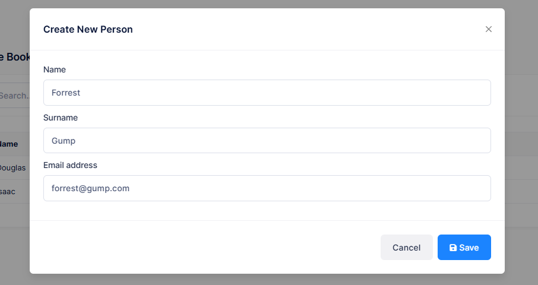

# Creating Modal for New Person

We will create a Bootstrap Modal to create a new person. ASP.NET Zero
uses [ngx-bootstrap](https://github.com/valor-software/ngx-bootstrap)
library to create modals (you can use another library, but we will use
it in this sample too). Final modal will be like below:



First of all, we should use **nswag/refresh.bat** to re-generate
service-proxies. This will generate the code that is needed to call
PersonAppService.**CreatePerson** method from client side. Notice that
you should rebuild & run the server side application before
re-generating the proxy scripts.

We are starting from creating a new component, named
**create-person-modal.component.ts** into client side phonebook folder:

```typescript
import { Component, ElementRef, inject, signal, viewChild, output } from '@angular/core';
import { email, form, FormField, FormRoot, maxLength, required } from '@angular/forms/signals';
import { ModalDirective, ModalModule } from 'ngx-bootstrap/modal';
import { PersonServiceProxy, CreatePersonInput } from '@shared/service-proxies/service-proxies';
import { AppComponentBase } from '@shared/common/app-component-base';
import { finalize } from 'rxjs/operators';
import { LocalizePipe } from '@shared/common/pipes/localize.pipe';
import { ButtonBusyDirective } from '@shared/utils/button-busy.directive';
import { ValidationMessagesComponent } from '@shared/utils/validation-messages.component';
import { toFormModel } from '@shared/utils/forms/form-model';

const toPersonFormModel = (person: CreatePersonInput) =>
    toFormModel(person, { name: '', surname: '', emailAddress: '' });

@Component({
    selector: 'createPersonModal',
    templateUrl: './create-person-modal.component.html',
    standalone: true,
    imports: [
        FormField,
        FormRoot,
        ModalModule,
        LocalizePipe,
        ButtonBusyDirective,
        ValidationMessagesComponent,
    ],
})
export class CreatePersonModalComponent extends AppComponentBase {
    private readonly _personService = inject(PersonServiceProxy);

    modalSave = output<any>();

    modal = viewChild.required<ModalDirective>('modal');
    nameInput = viewChild<ElementRef>('nameInput');

    person = signal(toPersonFormModel(new CreatePersonInput()));
    active = signal(false);
    saving = signal(false);

    personForm = form(
        this.person,
        (person) => {
            required(person.name);
            maxLength(person.name, 32);
            required(person.surname);
            maxLength(person.surname, 32);
            required(person.emailAddress);
            maxLength(person.emailAddress, 255);
            email(person.emailAddress);
        },
        { submission: { action: async () => this.save() } }
    );

    constructor() {
        super();
    }

    show(): void {
        this.personForm().reset(toPersonFormModel(new CreatePersonInput()));
        this.active.set(true);
        this.modal().show();
    }

    onShown(): void {
        this.nameInput()?.nativeElement.focus();
    }

    save(): void {
        const input = CreatePersonInput.fromJS(this.person());

        this.saving.set(true);
        this._personService
            .createPerson(input)
            .pipe(finalize(() => this.saving.set(false)))
            .subscribe(() => {
                this.notify.info(this.l('SavedSuccessfully'));
                this.close();
                this.modalSave.emit(input);
            });
    }

    close(): void {
        this.modal().hide();
        this.active.set(false);
    }
}
```

Let me explain some parts of this class:

- It has a selector, **createPersonModal**, which will be used as like
  an HTML element in the person list page.
- It extends **AppComponentBase** to take advantage of it (defines
  this.l and this.notify in this sample).
- Defines an event, **modalSave**, which is triggered when we
  successfully save the modal. Thus, the main page will be informed
  and it can reload the person list.
- Declares two **ViewChild** members (**modal** and **nameInput**) to
  access some elements in the view.
- Injects **PersonServiceProxy** to call server side method while
  creating the person.
- It focuses to **name** input when modal is shown.

The form is built with Angular
[Signal Forms](https://angular.dev/guide/forms/signals/overview):

- **person** is a signal that holds the form model. `toFormModel` turns
  the `CreatePersonInput` DTO into a plain object and gives the text
  fields an empty string as their initial value.
- **personForm** declares the validation rules (`required`, `maxLength`,
  `email`) in the component instead of in the HTML. The `submission`
  option calls `save()` when the form is submitted.
- **show()** resets the form, so the modal always opens with empty
  fields and no validation messages.
- **save()** creates a `CreatePersonInput` from the form model with
  `fromJS` and sends it to the server.
- The **active** flag removes the form from the page while the modal
  is closed.

As declared in the component, we are creating the
**create-person-modal.component.html** file in the same folder as shown
below:

```html
<div
    bsModal
    #modal="bs-modal"
    (onShown)="onShown()"
    class="modal fade"
    tabindex="-1"
    role="dialog"
    aria-labelledby="modal"
    aria-hidden="true"
    [config]="{ backdrop: 'static' }">
    <div class="modal-dialog modal-lg">
        <div class="modal-content">
            @if(active()){
                <form [formRoot]="personForm">
                    <div class="modal-header">
                        <h4 class="modal-title">
                            <span>{{ 'CreateNewPerson' | localize }}</span>
                        </h4>
                        <button type="button" class="btn-close" (click)="close()" aria-label="Close"></button>
                    </div>
                    <div class="modal-body">
                        <div class="mb-3">
                            <label for="name" class="form-label">{{ 'Name' | localize }}</label>
                            <input
                                #nameInput
                                id="name"
                                class="form-control"
                                type="text"
                                [formField]="personForm.name" />
                            <validation-messages [field]="personForm.name" />
                        </div>

                        <div class="mb-3">
                            <label for="surname" class="form-label">{{ 'Surname' | localize }}</label>
                            <input
                                id="surname"
                                class="form-control"
                                type="text"
                                [formField]="personForm.surname" />
                            <validation-messages [field]="personForm.surname" />
                        </div>

                        <div class="mb-3">
                            <label for="emailAddress" class="form-label">{{ 'EmailAddress' | localize }}</label>
                            <input
                                id="emailAddress"
                                class="form-control"
                                type="email"
                                [formField]="personForm.emailAddress" />
                            <validation-messages [field]="personForm.emailAddress" />
                        </div>
                    </div>
                    <div class="modal-footer">
                        <button [disabled]="saving()" type="button" class="btn btn-secondary" (click)="close()">
                            {{ 'Cancel' | localize }}
                        </button>
                        <button
                            type="submit"
                            class="btn btn-primary"
                            [disabled]="!personForm().valid() || saving()"
                            [buttonBusy]="saving()"
                            [busyText]="l('SavingWithThreeDot')">
                            <i class="fa fa-save"></i>
                            <span>{{ 'Save' | localize }}</span>
                        </button>
                    </div>
                </form>
            }
        </div>
    </div>
</div>
```

Open PhoneBookDemo.xml (the **default**, **English** localization dictionary) and add the following line:

```xml
<text name="CreateNewPerson">Create New Person</text>
```

Most of this code is similar for all modals. The important part is how
we bound the model to the view: the `form` element is connected to
**personForm** with `[formRoot]`, each input is bound to its field with
`[formField]`, and `<validation-messages>` shows the errors of that
field. The validation rules are declared in the component, so the inputs
do not need `name`, `required` or `maxlength` attributes. As like all
components, Angular requires to relate it to a module. We should update it to
**imports** array of **phonebook.component.ts** as like shown below:

```typescript
import { Component, inject, OnInit, signal, viewChild } from '@angular/core';
import { AppComponentBase } from '@shared/common/app-component-base';
import { appModuleAnimation } from '@shared/animations/routerTransition';
import { LocalizePipe } from '@shared/common/pipes/localize.pipe';
import { SubHeaderComponent } from '@app/shared/common/sub-header/sub-header.component';
import { PersonListDto, PersonServiceProxy } from '@shared/service-proxies/service-proxies';
import { FormsModule } from '@angular/forms';
import { CreatePersonModalComponent } from './create-person-modal.component';

@Component({
    selector: 'app-phone-book',
    templateUrl: './phonebook.component.html',
    animations: [appModuleAnimation()],
    standalone: true,
    imports: [SubHeaderComponent, LocalizePipe, FormsModule, CreatePersonModalComponent],
})
export class PhoneBookComponent extends AppComponentBase implements OnInit {
    private readonly _personService = inject(PersonServiceProxy);

    createPersonModal = viewChild.required<CreatePersonModalComponent>('createPersonModal');

    people = signal<PersonListDto[]>([]);
    filter = signal('');

    constructor() {
        super();
    }

    ngOnInit(): void {
        this.getPeople();
    }

    getPeople(): void {
        this.nzTableHelper.showLoadingIndicator();
        this._personService.getPeople(this.filter()).subscribe((result) => {
            this.people.set(result.items);
            this.nzTableHelper.hideLoadingIndicator();
        });
    }

    createPerson(): void {
        this.createPersonModal().show();
    }
}
```

We need to put a "Create new person" button to the 'people list page' to
open the modal when clicked to the button. To do that, we made the
following changes in **phonebook.component.html**:

```html
<div [@routerTransition]>
    <sub-header [title]="'PhoneBook' | localize" [description]="'PhoneBooksHeaderInfo' | localize"></sub-header>
    <div [class]="containerClass">
        <div class="card card-custom">
            <div class="card-header">
                <div class="card-toolbar">
                    <button (click)="createPerson()" class="btn btn-primary">
                        <i class="fa fa-plus"></i> {{ 'CreateNewPerson' | localize }}
                    </button>
                </div>
            </div>
            <div class="card-body">
                <div class="table-responsive">
                    <table class="table table-responsive table-bordered">
                        <thead class="bg-light">
                            <tr>
                                <th>{{ 'Name' | localize }}</th>
                                <th>{{ 'Surname' | localize }}</th>
                                <th>{{ 'EmailAddress' | localize }}</th>
                            </tr>
                        </thead>
                        <tbody>
                            @for (person of people(); track person.id) {
                                <tr>
                                    <td>{{ person.name }}</td>
                                    <td>{{ person.surname }}</td>
                                    <td>{{ person.emailAddress }}</td>
                                </tr>
                            }
                        </tbody>
                    </table>
                </div>
            </div>
        </div>
    </div>
</div>

<createPersonModal #createPersonModal (modalSave)="getPeople()"></createPersonModal>
```

Made some minor changes in the view; Added a **button** to open the
modal and the **createPersonModal** component as like another HTML tag
(which matches to the selector in the
**create-person-modal.component.ts**).

## Next

- [Authorization For Phone Book](Developing-Step-By-Step-Angular-Authorization-PhoneBook)