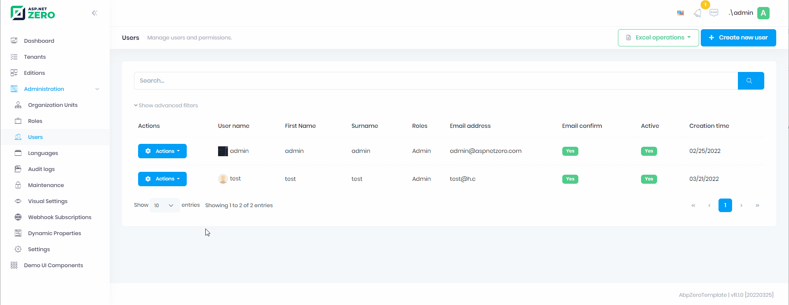
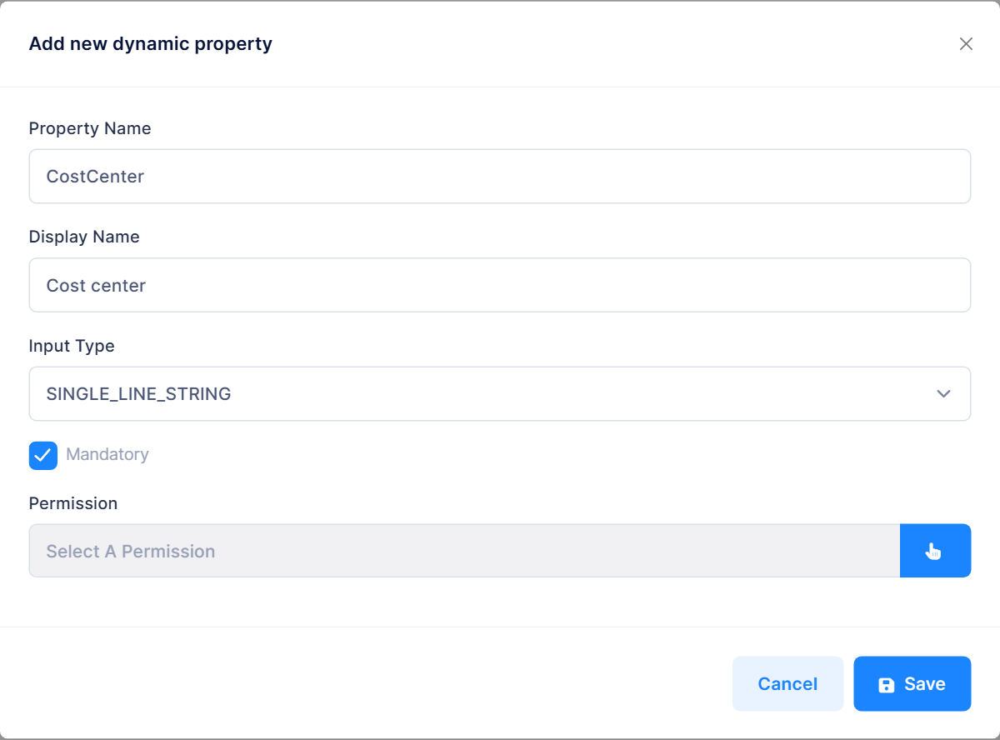

# Dynamic Property System

**Dynamic Property System** is a system that allows you to add and manage new properties on entity objects at runtime without any code changes. With this system, you can define dynamic propeties on entity objects and perform operations on these objects easily. For example, it can be used for cities, counties, gender, status codes etc.

Check AspNet Boilerplate side of [Dynamic Property System](https://aspnetboilerplate.com/Pages/Documents/Dynamic-Parameter-System)

### Defining

* Firs of all you need to define input types and entities you want to use with dynamic properties as described [here](https://aspnetboilerplate.com/Pages/Documents/Dynamic-Parameter-System#dynamic-property-definition)

* Then go to https://localhost:44302/App/DynamicProperty

* Add Dynamic Properties that you need

* Assign Dynamic Properties to your entity


* Then you will be able to use dynamic property for the items of your entity.

You can use `DynamicEntityPropertyManager` to manager dynamic properties of an entity

Add javascript

```html
<script abp-src="/view-resources/Areas/AppAreaName/Views/Common/_DynamicEntityPropertyManager.js" asp-append-version="true"></script>
```
Then you can use it to show modal
```javascript
var _dynamicEntityPropertyManager = new DynamicEntityPropertyManager();

var canShow = _dynamicEntityPropertyManager.canShow('YOURENTITYNAME');//is entity defined and user has related permission to edit dynamic entities
if(canShow){
    _dynamicEntityPropertyManager.modal.open({
        entityFullName: 'MyCompanyName.AbpZeroTemplate.Authorization.Users.User',
        rowId: data.record.id,
    });
}
```
For example you can use it in list page action
```javascript
var dataTable = _$usersTable.DataTable({
        //...
        columnDefs: [
            {
                targets: 1,
                data: null,
                orderable: false,
                autoWidth: false,
                defaultContent: '',
                rowAction: {
                    text:
                        '<i class="fa fa-cog"></i> <span class="d-none d-md-inline-block d-lg-inline-block d-xl-inline-block">' +
                        app.localize('Actions') +
                        '</span> <span class="caret"></span>',
                    items: [
                        //..
                        {
                            text: app.localize('DynamicProperties'),
                            visible: function () {
                                return _dynamicEntityPropertyManager.canShow(
                                    'MyCompanyName.AbpZeroTemplate.Authorization.Users.User'
                                );
                            },
                            action: function (data) {
                                _dynamicEntityPropertyManager.modal.open({
                                    entityFullName: 'MyCompanyName.AbpZeroTemplate.Authorization.Users.User',
                                    rowId: data.record.id,
                                });
                            },
                        }
                    ]
                }
            }

        ],
    });
```


### Mandatory Dynamic Properties

Select **Mandatory** while adding or editing a dynamic property to require a value for it.



When you manage the dynamic property values of an entity, mandatory properties are marked with `*` and follow these rules:

* **Saving fails when a mandatory value is missing.** A warning lists the empty properties and nothing is saved. `InsertOrUpdateAllValues` applies the same check on the server, so API requests with a missing value are rejected too.

* **Values of a mandatory property can't be deleted.** The **Delete** button isn't shown for these properties, and `CleanValues` rejects the request. You can still replace a value with a new one.

These rules apply only when dynamic property values are saved or deleted. Creating the entity itself doesn't require a value, so a new entity has no value for a mandatory property until one is saved.

_____

<table>
    <thead>
    	<tr>
            <th>Property</th>
            <th>Summary</th>
        </tr>
    </thead>
    <tbody>
    	<tr>
            <td>PropertyName*</td>
            <td>Unique name of the dynamic property</td>
        </tr>
         <tr>
            <td>Input Type*</td>
            <td>Input type name of the dynamic property</td>
        </tr>
         <tr>
            <td>Mandatory</td>
            <td>Requires a value for the property when the dynamic property values of an entity are saved, and prevents those values from being deleted</td>
        </tr>  
         <tr>
            <td>Permission</td>
            <td>Required permission to manage anything about that property <br><span style="font-style: italic;">(<code>DynamicPropertyValue</code>, <code>EntityDynamicProperty</code>, <code>EntityDynamicPropertyValue</code>)</span></td>
        </tr>   
    </tbody>
</table>
