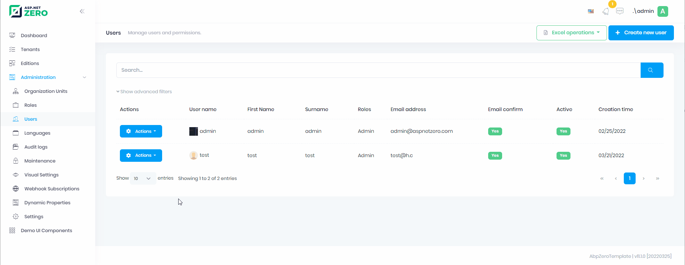
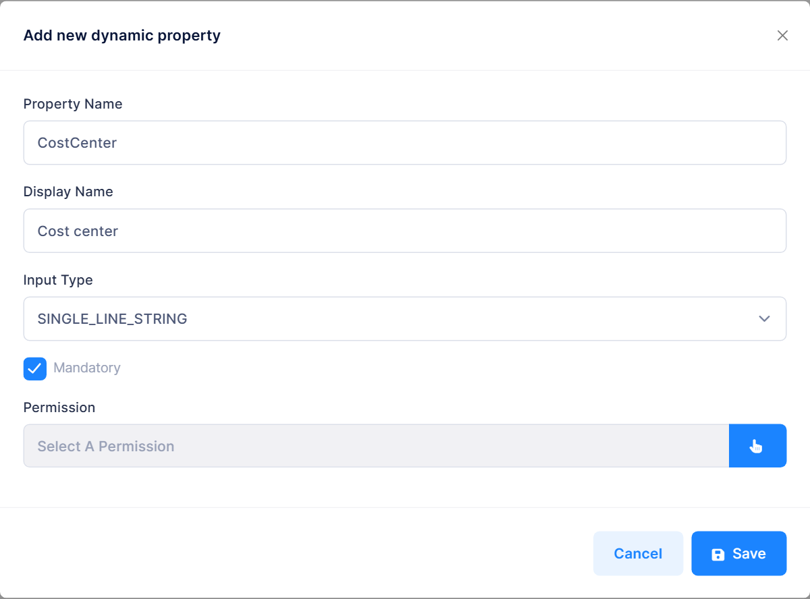

# Dynamic Property System

**Dynamic Property System** is a system that allows you to add and manage new properties on entity objects at runtime without any code changes. With this system, you can define dynamic properties on entity objects and perform operations on these objects easily. For example, it can be used for cities, counties, gender, status codes etc.

Check AspNet Boilerplate side of [Dynamic Property System](https://aspnetboilerplate.com/Pages/Documents/Dynamic-Parameter-System)

### Defining

* First of all you need to define input types and entities you want to use with dynamic properties as described [here](https://aspnetboilerplate.com/Pages/Documents/Dynamic-Parameter-System#dynamic-property-definition)

* Then go to http://localhost:4200/app/admin/dynamic-property

* Add Dynamic Properties that you need

* Assign Dynamic Properties to your entity


* Then you will be able to use dynamic property for the items of your entity.

### Managing Dynamic Properties of an Entity

You can navigate users to the dynamic property value management page using React Router. The route pattern is:

```
/app/admin/dynamic-entity-property-value/manage-all/:entityFullName/:rowId
```

Here's an example of adding a "Dynamic Properties" action to a user's action menu in [users/index.tsx](../src/pages/admin/users/index.tsx):

```tsx
import { useNavigate } from "react-router-dom";
import { useServiceProxy } from "@/api/service-proxy-factory";
import {
  DynamicEntityPropertyDefinitionServiceProxy,
} from "@api/generated/service-proxies";

const UsersPage: React.FC = () => {
  const navigate = useNavigate();
  const dynamicEntityPropertyDefinitionService = useServiceProxy(
    DynamicEntityPropertyDefinitionServiceProxy,
    [],
  );
  
  // State to track if entity has dynamic properties
  const [entityHasDynamicProperties, setEntityHasDynamicProperties] = useState(false);
  
  // Check if the User entity has any dynamic properties assigned
  useEffect(() => {
    const checkDynamicProperties = async () => {
      const entities = await dynamicEntityPropertyDefinitionService.getAllEntities();
      const hasProperties = (entities ?? []).some(
        (e) => e === "MyCompanyName.AbpZeroTemplate.Authorization.Users.User"
      );
      setEntityHasDynamicProperties(hasProperties);
    };
    checkDynamicProperties();
  }, [dynamicEntityPropertyDefinitionService]);
  
  // Navigate to dynamic properties management page
  const showDynamicProperties = (user: UserListDto) => {
    navigate(
      `/app/admin/dynamic-entity-property-value/manage-all/MyCompanyName.AbpZeroTemplate.Authorization.Users.User/${user.id}`
    );
  };
  
  // Add to menu items
  const getMenuItems = (record: UserListDto) => {
    const items = [];
    
    // ... other menu items ...
    
    if (entityHasDynamicProperties) {
      items.push({
        key: "dynamicProperties",
        label: L("DynamicProperties"),
        onClick: () => showDynamicProperties(record),
      });
    }
    
    return items;
  };
  
  // ... rest of the component
};
```

### Using DynamicPropertyValueManager Component Directly

You can also use the `DynamicPropertyValueManager` component directly in a modal or inline. The component is located at [DynamicPropertyValueManager.tsx](../src/pages/admin/dynamic-properties/dynamic-entity-property-values/components/DynamicPropertyValueManager.tsx):

```tsx
import { useRef } from "react";
import { Modal } from "antd";
import DynamicPropertyValueManager, {
  type DynamicPropertyValueManagerRef,
} from "@/pages/admin/dynamic-properties/dynamic-entity-property-values/components/DynamicPropertyValueManager";
import L from "@/lib/L";

interface Props {
  visible: boolean;
  entityFullName: string;
  entityId: string;
  onClose: () => void;
}

const DynamicPropertiesModal: React.FC<Props> = ({
  visible,
  entityFullName,
  entityId,
  onClose,
}) => {
  const managerRef = useRef<DynamicPropertyValueManagerRef>(null);

  const handleSave = async () => {
    const saved = await managerRef.current?.saveAll();
    if (saved) {
      onClose();
    }
  };

  return (
    <Modal
      title={L("DynamicProperties")}
      open={visible}
      onOk={handleSave}
      onCancel={onClose}
      width={800}
    >
      <DynamicPropertyValueManager
        ref={managerRef}
        entityFullName={entityFullName}
        entityId={entityId}
      />
    </Modal>
  );
};
```



### Mandatory Dynamic Properties

Select **Mandatory** while adding or editing a dynamic property to require a value for it.



When you manage the dynamic property values of an entity, mandatory properties follow these rules:

* **Saving fails when a mandatory value is missing.** A warning lists the empty properties, `saveAll` returns `false` and nothing is saved. `InsertOrUpdateAllValues` applies the same check on the server, so API requests with a missing value are rejected too.

* **Values of a mandatory property can't be deleted.** The **Delete** button isn't shown for these properties, and `CleanValues` rejects the request. You can still replace a value with a new one.

These rules apply only when dynamic property values are saved or deleted. Creating the entity itself doesn't require a value, so a new entity has no value for a mandatory property until one is saved.

_____

<table>
    <thead>
    	<tr>
            <th>Property</th>
            <th>Summary</th>
        </tr>
    </thead>
    <tbody>
    	<tr>
            <td>PropertyName*</td>
            <td>Unique name of the dynamic property</td>
        </tr>
         <tr>
            <td>Input Type*</td>
            <td>Input type name of the dynamic property</td>
        </tr>
         <tr>
            <td>Mandatory</td>
            <td>Requires a value for the property when the dynamic property values of an entity are saved, and prevents those values from being deleted</td>
        </tr>  
         <tr>
            <td>Permission</td>
            <td>Required permission to manage anything about that property <br><span style="font-style: italic;">(<code>DynamicPropertyValue</code>, <code>EntityDynamicProperty</code>, <code>EntityDynamicPropertyValue</code>)</span></td>
        </tr>   
    </tbody>
</table>

