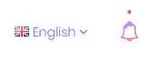
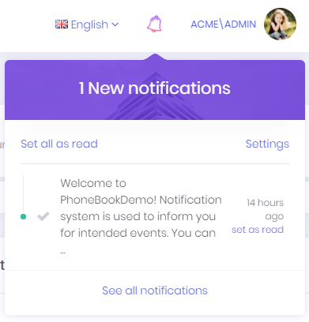
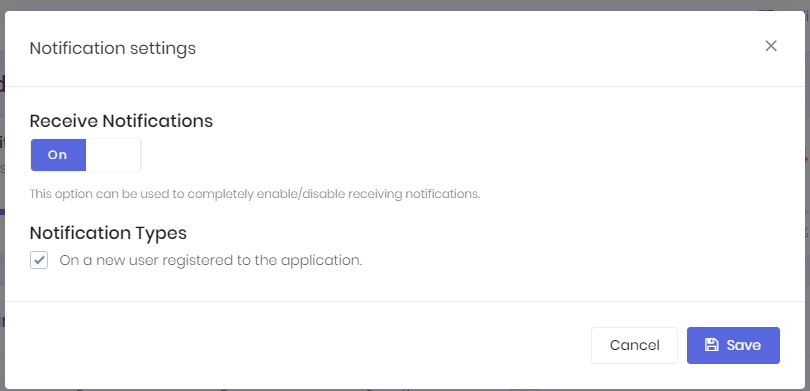
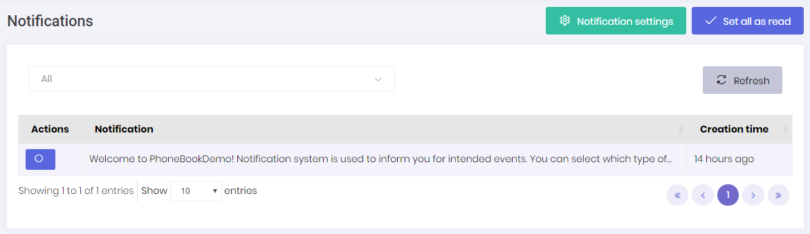

# Notifications

Notification icon is located next to the language selection button. The number in the red circle shows unread notification count.



User can see 3 recent notifications by clicking this icon.



User can marks all notifications as read by clicking the "Set all as read" link or can mark a single notification by clicking the "set as read" link next to each notification.

Notifications are sent real-time using SignalR. In addition, a **desktop notification** is shown when a notification is received, if the user has allowed desktop notifications in the browser (see [Desktop Notifications](#desktop-notifications)).

## Notification Settings

"Settings" link opens notification settings dialog.



In this dialog there is a global setting for user to enable/disable receiving notifications. If this setting is enabled, then user can enable/disable each notification individually. The dialog also has a **Desktop Notifications** section, where the user can allow desktop notifications for the current browser.

You can also define your custom notifications in **AppNotificationProvider** class. For example, new user registration notification is defined in the **AppNotificationProvider** as below.

```
context.Manager.Add(
     new NotificationDefinition(
        AppNotificationNames.NewUserRegistered,
        displayName: L("NewUserRegisteredNotificationDefinition"),
        permissionDependency: new SimplePermissionDependency(AppPermissions.Pages_Administration_Users)
    )
);
```

See [notification definitions](https://aspnetboilerplate.com/Pages/Documents/Notification-System#notification-definitions) section for detailed information.

**AppNotifier** class is used to publish notifications. **NotificationAppService** class is used to manage application logic for notifications. See [notifications documentation](https://aspnetboilerplate.com/Pages/Documents/Notification-System) for detailed information.

## Desktop Notifications

Desktop notifications are shown with the browser's native [Notifications API](https://developer.mozilla.org/en-US/docs/Web/API/Notifications_API). No third-party library is used.

### Allowing desktop notifications

The browser shows a desktop notification only if the user has allowed notifications for your site. Browsers only let a site ask for this permission after a user action, so ASP.NET Zero does not ask for it automatically. Instead, the **Desktop Notifications** section of the notification settings dialog shows the current permission of the browser:

| Browser permission | What the dialog shows |
|--------------------|-----------------------|
| Not asked yet | An **Enable desktop notifications** button. Clicking it opens the permission prompt of the browser. |
| Allowed | *"Desktop notifications are enabled for this browser."* |
| Blocked | *"Desktop notifications are blocked for this browser. You can allow them from the browser's site settings."* |
| Not supported | *"This browser does not support desktop notifications."* |

The permission belongs to the browser, not to the user account. It is not saved to the server, so the user allows desktop notifications separately on each browser. If the user has blocked notifications, the browser does not show the prompt again. The user has to allow notifications from the site settings of the browser.

Desktop notifications are supported on desktop browsers only. Mobile browsers, such as Chrome for Android, only show notifications that come from a service worker. ASP.NET Zero does not use a service worker for desktop notifications, so on these browsers the dialog can show desktop notifications as enabled, but no notification appears.

> Browsers only allow notifications on secure (HTTPS) pages. `localhost` is treated as secure, so desktop notifications also work during local development. On a page that is not secure, the dialog shows desktop notifications as blocked or not supported, depending on the browser, and allowing them from the site settings of the browser does not help.

### How desktop notifications work

When a notification is received via SignalR and the permission is granted:

- The notification is shown with the project name as the title, the notification text as the body and the application logo as the icon.
- The id of the user notification is used as the tag of the desktop notification. If the same notification is received again, it replaces the existing desktop notification instead of adding a second one.
- Clicking the notification focuses the application window and closes the notification.
- The notification closes automatically after 6 seconds.

Desktop notifications are shown only while the application is open in a browser tab. They are not Web Push notifications, so nothing is shown after the user closes the application.

### Customizing desktop notifications

Desktop notifications are handled by the `app.desktopNotification` object, which is defined in `wwwroot/Common/Scripts/desktopNotification.js`:

| Member | Description |
|--------|-------------|
| `isSupported()` | Returns `true` if the browser supports the Notifications API. |
| `getPermission()` | Returns `granted`, `denied`, `default` (not asked yet) or `unsupported`. |
| `requestPermission()` | Opens the permission prompt of the browser if the permission was not asked yet. Returns a promise that resolves to the resulting permission. Call it only from a user action, such as a button click. |
| `show(title, options)` | Shows a desktop notification if the permission is granted. `options` has `body`, `icon` and an optional `tag`. |
| `autoCloseDelay` | The time in milliseconds after which a desktop notification is closed (`6000`). Changing this property has no effect. To use another delay, change the `autoCloseDelay` variable at the top of the file. |

The `show` function in `wwwroot/Common/Scripts/appUserNotificationHelper.js` calls `app.desktopNotification.show`. Change this call to customize the title, text or icon of the desktop notifications.

Both files are part of the script bundles that are defined in `bundles.json`, so the bundles have to be updated after you change them. See [Bundling & Minifying](Infrastructure-Core-Mvc-Bundling-Minifying-Compiling).

## Notification List

All notifications of user are listed in this page.



## Upgrading from an Earlier Version

Earlier versions showed desktop notifications with the [Push.js](https://github.com/Nickersoft/push.js) package, which is archived and no longer maintained. If you upgrade an existing project, make the following changes:

- In `bundles.json`, remove `node_modules/push.js/bin/push.js` from the `app-layout-libs` script bundle, and add `wwwroot/Common/Scripts/desktopNotification.js` to the `common-scripts` and `install-page-scripts` bundles.
- Remove the `push.js` package from `package.json`.
- Add `wwwroot/Common/Scripts/desktopNotification.js`.
- In `wwwroot/Common/Scripts/appUserNotificationHelper.js`, replace the `Push.create` call in the `show` function with an `app.desktopNotification.show` call. If you changed the options of the old call, apply your changes to the new call. The `timeout` option is replaced by the `autoCloseDelay` variable of `desktopNotification.js`, and the click behaviour is in its `show` function.
- Add the **Desktop Notifications** section to `Areas/AppAreaName/Views/Notifications/_SettingsModal.cshtml` and `wwwroot/view-resources/Areas/AppAreaName/Views/Notifications/_SettingsModal.js`.
- Add the `DesktopNotifications`, `DesktopNotifications_Definition`, `DesktopNotifications_Enable`, `DesktopNotifications_Granted`, `DesktopNotifications_Denied` and `DesktopNotifications_NotSupported` localization keys to the localization files in the `Localization/AbpZeroTemplate` folder of the `*.Core` project. ASP.NET Zero only adds them to the English file, `AbpZeroTemplate.xml`, so other languages show the English texts until you translate them.
- Re-create the bundles with `npm run create-bundles`, or with `npm run build` before you publish. Both commands also run `pnpm install`, so the `push.js` package is removed from `node_modules`. See [Bundling & Minifying](Infrastructure-Core-Mvc-Bundling-Minifying-Compiling).

Earlier versions asked for the permission of the browser when the first notification was received. Now the permission is asked only when the user clicks **Enable desktop notifications** in the notification settings dialog. Users who already allowed notifications for your site do not need to do anything.

## Next

- [Chat](Features-Mvc-Core-Chat)