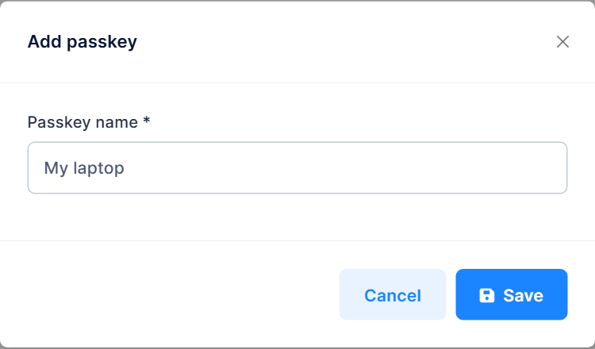
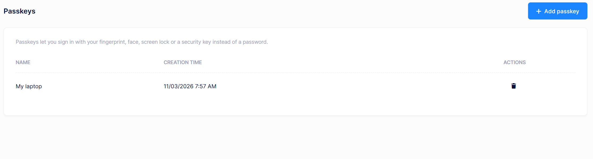
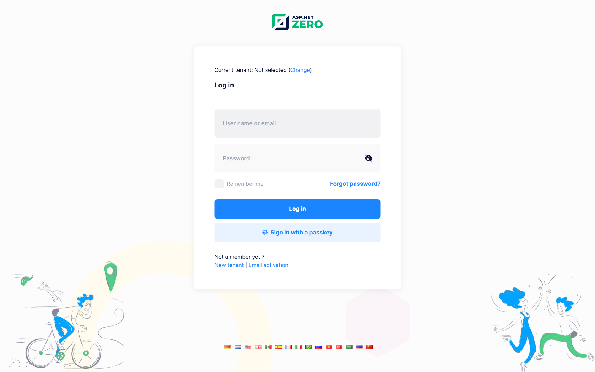

# Passkeys

ASP.NET Zero supports **passkey (WebAuthn) login**. Users can sign in with their fingerprint, face, screen lock or a security key instead of a password.

The private key of a passkey stays on the user's device or in their password manager. The server stores only the public key, so there is no shared secret to steal. A passkey is also bound to your site's domain, which makes it resistant to phishing.

Passkey login is built on the [passkey support of ASP.NET Core Identity](https://learn.microsoft.com/en-us/aspnet/core/security/authentication/passkeys/) in .NET 10.

## Enabling Passkey Login

Passkey login is **off by default**. To turn it on, a host administrator navigates to **Administration > Settings > User Management** and selects **Allow users to sign in with passkeys** in the **Passkeys** section.

| Setting | Setting name | Default |
|---------|--------------|---------|
| **Allow users to sign in with passkeys** | `App.UserManagement.IsPasskeyLoginEnabled` | `false` |

The setting is defined for both the host and tenants:

- Once the host turns it on, it applies to every tenant.
- Tenant administrators see the same option in their own settings, and they can turn passkeys off for their tenant.
- A tenant cannot turn passkeys on while the host has them off. The option is not shown to tenants in that case.

The initial value can also be set in `appsettings.json` before the first run:

```json
{
  "App": {
    "App.UserManagement.IsPasskeyLoginEnabled": "true"
  }
}
```

> Values in `appsettings.json` are only the **initial defaults**. Once the value has been changed on the settings page, it is stored in the database and the configuration file no longer has any effect on it.

When passkey login is off, the login button and the **Passkeys** link in the user menu are hidden, and the **Passkeys** page returns `404`. Passkeys that were already added stay in the database, but they cannot be used until the feature is turned on again.

## Adding a Passkey

Users manage their own passkeys from **user menu > Passkeys**, at `/App/MyPasskeys`. Every signed-in user can use this page. It does not require a permission.

> The controllers live in the `AppAreaName` area, which is renamed to your own area name (`App` by default) when the project is generated.

To add a passkey:

1. Click **Add passkey**.
2. Enter a name that helps the user recognize the passkey, for example `My laptop`. A name can be up to 64 characters long.
3. Click **Save** and complete the verification that the browser asks for.



A user can add more than one passkey, for example one for each device. The page lists each passkey with its name and creation time. Use the delete action to remove a passkey that is no longer needed.



If the browser does not support passkeys, the page shows the message *"Your browser does not support passkeys."*

> Passkeys are the login credentials of a user, so they can only be managed by the user. They cannot be added or deleted while impersonating another user or by a request that is authenticated with an [API key](Features-Mvc-Core-Api-Keys).

## Signing In with a Passkey

When passkey login is on and the browser supports passkeys, the login page shows a **Sign in with a passkey** button.



The user does not have to enter a user name. The browser lists the passkeys that are available for the site, and the user picks one and completes the verification.

Passkeys are looked up in the **current tenant** only. In a multi-tenant application, the user must select their tenant on the login page first, or open the tenant's subdomain.

A passkey login follows these rules:

| Rule | Behaviour |
|------|-----------|
| **Two-factor authentication** | A passkey replaces the two-factor verification step, so the user is not asked for a two-factor code. |
| **Forced password change** | Still applies. If the user must change their password on next login, they are asked to do so after signing in with a passkey. |
| **Lockout** | A locked out user cannot sign in. A failed passkey verification counts as a failed attempt for the owner of the passkey, like a wrong password. |
| **Inactive tenants** | Users of an inactive tenant cannot sign in. |
| **Login attempts** | Successful and failed passkey logins are saved to the login attempts. |

## Configuration

### Relying party domain

WebAuthn binds every passkey to a domain, called the relying party id. ASP.NET Zero reads it from the `Authentication:Passkey:ServerDomain` value in the `appsettings.json` file of the `Web.Mvc` project:

```json
{
  "Authentication": {
    "Passkey": {
      "ServerDomain": ""
    }
  }
}
```

- When the value is **empty**, the host of the page that sent the request is used.
- When the value is **set**, it must be the host of the page that runs the passkey ceremony, or a parent domain of it. For example, `mydomain.com` works for both `tenant1.mydomain.com` and `www.mydomain.com`.

Set a parent domain if your users sign in on more than one subdomain. Otherwise, a passkey that was added on one subdomain cannot be used on another.

> Existing passkeys stop working if you change `ServerDomain` or move the application to another domain. Users have to sign in with another method and add their passkeys again.

### Deployment requirements

- **HTTPS:** Browsers only allow passkeys on secure pages. `localhost` is the only exception, which makes local development possible.
- **Shared cache:** The state of a passkey ceremony is kept in the `AppPasskeyStateCache` cache for 5 minutes. If you run more than one instance of the application, use a shared cache such as Redis so that every instance can read it. If the state cannot be found, the user sees *"The passkey request has expired. Please try again."*

### Other WebAuthn options

Other WebAuthn options can be customized with `IdentityPasskeyOptions`. Add your changes to the `Configure` method of `PasskeyConfigurer` in the `Web.Core` project:

```csharp
services.Configure<IdentityPasskeyOptions>(options =>
{
    options.AuthenticatorTimeout = TimeSpan.FromMinutes(3);
});
```

## Database

Passkeys are stored in the `AbpUserPasskeys` table, which is mapped to the `UserPasskey` entity of ASP.NET Boilerplate. The table is created by the `Added_UserPasskeys` migration.

## Application Service and Endpoints

`IPasskeyAppService` lets the current user manage their own passkeys:

| Method | Description |
|--------|-------------|
| `GetMyPasskeys` | Lists the passkeys of the current user. |
| `CreateRegistrationOptions` | Starts adding a passkey and returns the options for the browser. |
| `RegisterPasskey` | Verifies the browser's response and saves the passkey. |
| `DeletePasskey` | Deletes a passkey of the current user. |

The login page uses these endpoints:

| Endpoint | Description |
|----------|-------------|
| `Account/GetPasskeyLoginOptions` | Starts a passkey login and returns the options for the browser. |
| `Account/PasskeyLogin` | Verifies the browser's response and signs the user in. |

## Next

- [Email Templates](Features-Mvc-Core-Email-Templates)
