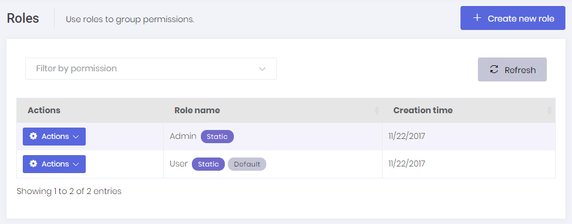
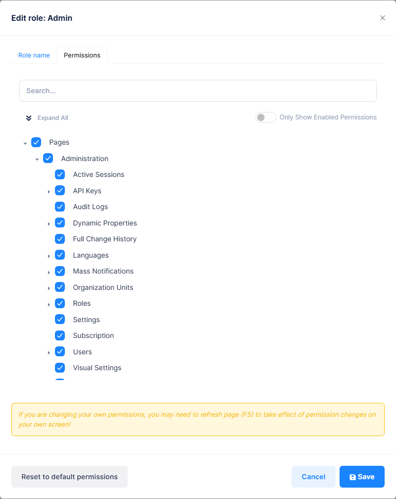

#### Role Management

When we click Administration/Roles menu, we enter the role management page:



Roles are used to **group permissions**. When a user has a role, then he/she will have all permissions of that role.

A role is represented by the **Role** class. Role class can be extended by adding new properties.

**RoleManager** performs domain logic, **RoleAppService** performs application logic for roles.

Roles can be dynamic or static:

- **Static role**: A static role has a known **name** (like 'admin') and can not change this name (we can change **display name**). It's exists on the system startup and can not be deleted. Thus, we can write our code based on a static role name.
- **Dynamic role**: We can create a dynamic role after deployment. Then we can grant permissions for that role, we can assign the role to some users and we can delete it. We can not know the names of dynamic roles in development time.

One or more roles can be set as **default**. Default roles are assigned to new added/registered users as default. This is not a development time property and can be set or changed after deployment.

In startup project, we have static **admin** role for host (for multi-tenant apps). Also, we have static **admin** and **user** roles for tenants. **Admin** roles have all permissions granted by default. **User** role is the **default** role for new users and has no permission by default. These can be changed easily. See **StaticRoleNames** class for all static roles and **AppRoleConfig** for changing static roles.

##### Role Permissions

Since roles are used to group permissions, we can set permissions of a role while creating or editing as shown below:



*Note that not all permissions shown in the figure above*

Every tenant has its own roles and any change in roles for a tenant does not affect other tenants. Also, host has also own isolated roles.

##### Resetting Role Permissions

Permissions of a static role can be changed like the permissions of any other role, and after a while it may be hard to tell which permissions the role had at the beginning. To go back, open the static role and click the **Reset to default permissions** button in the edit role modal. After you confirm, all permission changes made for that role are removed and the role gets its default permissions back. The change is saved immediately and affects every user in the role.

The default permissions of a static role come from its definition in the **AppRoleConfig** class. A static role defined with `grantAllPermissionsByDefault: true` gets all permissions back, and any other static role gets the permissions in its `GrantedPermissions` list. In the startup project, this means the **admin** roles get all permissions back and the **user** role gets no permission back. The button is not shown for dynamic roles, since they have no default permissions to go back to.

If you want a static role to start with some permissions, add them to its definition in **AppRoleConfig**:

```csharp
roleManagementConfig.StaticRoles.Add(
    new StaticRoleDefinition(
        StaticRoleNames.Tenants.User,
        MultiTenancySides.Tenant)
    {
        GrantedPermissions =
        {
            AppPermissions.Pages_DemoUiComponents
        }
    }
);
```

Permissions granted to a role from code, for example in **TenantRoleAndUserBuilder**, are stored like the changes made on the UI, so resetting the role removes them as well. Define default permissions in **AppRoleConfig** so that they survive a reset.

On the server side, the reset is done by the `ResetRolePermissions` method of **RoleAppService**, which calls `RoleManager.ResetPermissionsToDefaultAsync`.

## Next

- [User Management](Features-Mvc-Core-User-Management)


