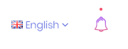
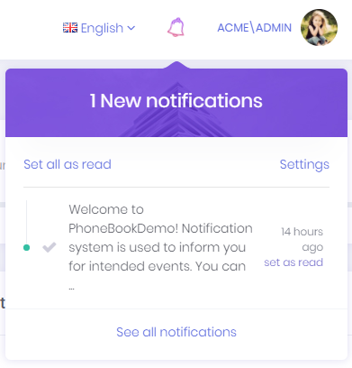
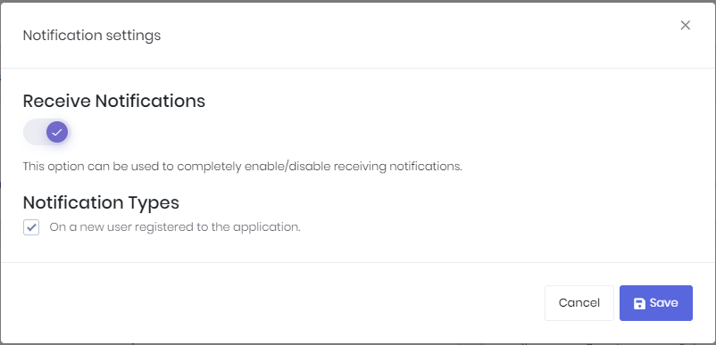
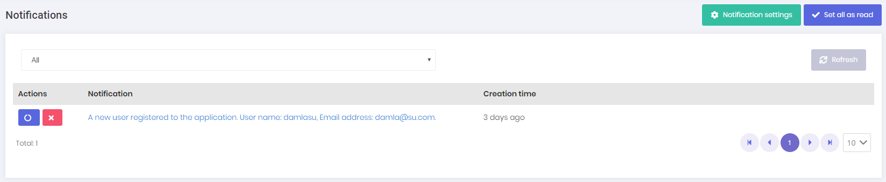

# Notifications

Notification icon is located next to the language selection button. 



User can see 3 recent notifications by clicking this icon.



User can marks all notifications as read by clicking the **Set all as read** link or can mark a single notification by clicking the **Set as read** link next to each notification. Notifications are sent real-time using SignalR. In addition, a **desktop notification** is shown when a notification is received, if the user has allowed desktop notifications in the browser (see [Desktop Notifications](#desktop-notifications)).

## Notification Settings

**Settings** link opens notification settings dialog.



In this dialog there is a global setting for user to enable/disable receiving notifications. If this setting is enabled, then user can enable/disable each notification individually. The dialog also has a **Desktop Notifications** section, where the user can allow desktop notifications for the current browser.

You can also define your custom notifications in **AppNotificationProvider** class. For example, new user registration notification is defined in the **AppNotificationProvider** as below.

````csharp
context.Manager.Add(
     new NotificationDefinition(
        AppNotificationNames.NewUserRegistered,
        displayName: L("NewUserRegisteredNotificationDefinition"),
        permissionDependency: new SimplePermissionDependency(AppPermissions.Pages_Administration_Users)
    )
);
````

See [notification definitions](https://aspnetboilerplate.com/Pages/Documents/Notification-System#notification-definitions) section for detailed information.

**AppNotifier** class is used to publish notifications. **NotificationAppService** class is used to manage application logic for notifications. 

When a notification is sent, the React app receives it via SignalR. Notification formatting is handled in [utils.ts](../src/pages/admin/notifications/utils.ts) which contains the `formatAbpUserNotification` function. If you want to customize how notification URLs are generated, you can modify the URL building logic in this file. 

See [notifications documentation](https://aspnetboilerplate.com/Pages/Documents/Notification-System) for detailed information.

## Desktop Notifications

Desktop notifications are shown with the browser's native [Notifications API](https://developer.mozilla.org/en-US/docs/Web/API/Notifications_API). No third-party library is used.

### Allowing desktop notifications

The browser shows a desktop notification only if the user has allowed notifications for your site. Browsers only let a site ask for this permission after a user action, so ASP.NET Zero does not ask for it automatically. Instead, the **Desktop Notifications** section of the notification settings dialog shows the current permission of the browser:

| Browser permission | What the dialog shows |
|--------------------|-----------------------|
| Not asked yet | An **Enable desktop notifications** button. Clicking it opens the permission prompt of the browser. |
| Allowed | *"Desktop notifications are enabled for this browser."* |
| Blocked | *"Desktop notifications are blocked for this browser. You can allow them from the browser's site settings."* |
| Not supported | *"This browser does not support desktop notifications."* |

The permission belongs to the browser, not to the user account. It is not saved to the server, so the user allows desktop notifications separately on each browser and device. If the user has blocked notifications, the browser does not show the prompt again. The user has to allow notifications from the site settings of the browser.

> Browsers only allow notifications on secure (HTTPS) pages. `localhost` is treated as secure, so desktop notifications also work during local development.

### How desktop notifications work

When a notification is received via SignalR and the permission is granted:

- The notification is shown with the project name as the title, the notification text as the body and the application logo as the icon.
- The id of the user notification is used as the tag of the desktop notification. If the same notification is received again, it replaces the existing desktop notification instead of adding a second one.
- Clicking the notification focuses the application window and closes the notification.
- The notification closes automatically after 6 seconds.

Desktop notifications are shown only while the application is open in a browser tab. They are not Web Push notifications, so nothing is shown after the user closes the application.

### Customizing desktop notifications

Desktop notifications are handled by the functions in `src/lib/desktop-notification.ts`:

| Export | Description |
|--------|-------------|
| `isDesktopNotificationSupported()` | Returns `true` if the browser supports the Notifications API. |
| `getDesktopNotificationPermission()` | Returns `granted`, `denied`, `default` (not asked yet) or `unsupported`. |
| `requestDesktopNotificationPermission()` | Opens the permission prompt of the browser if the permission was not asked yet, and returns the resulting permission. Call it only from a user action, such as a button click. |
| `showDesktopNotification(title, options)` | Shows a desktop notification if the permission is granted. `options` has `body`, `icon` and an optional `tag`. |
| `DESKTOP_NOTIFICATION_AUTO_CLOSE_DELAY` | The time in milliseconds after which a desktop notification is closed (`6000`). To use another delay, change its value in the file. |

The `showUiAndDesktopNotification` function in `src/pages/admin/notifications/utils.ts` calls `showDesktopNotification`. Change this call to customize the title, text or icon of the desktop notifications.

## Notification List

All notifications of the user are listed in this page. We can delete and mark a notification as read in this page.



## Next

- [Chat](Features-React-Chat)
