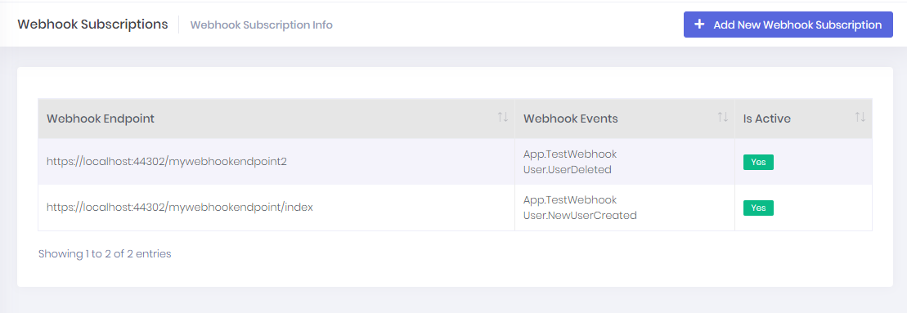
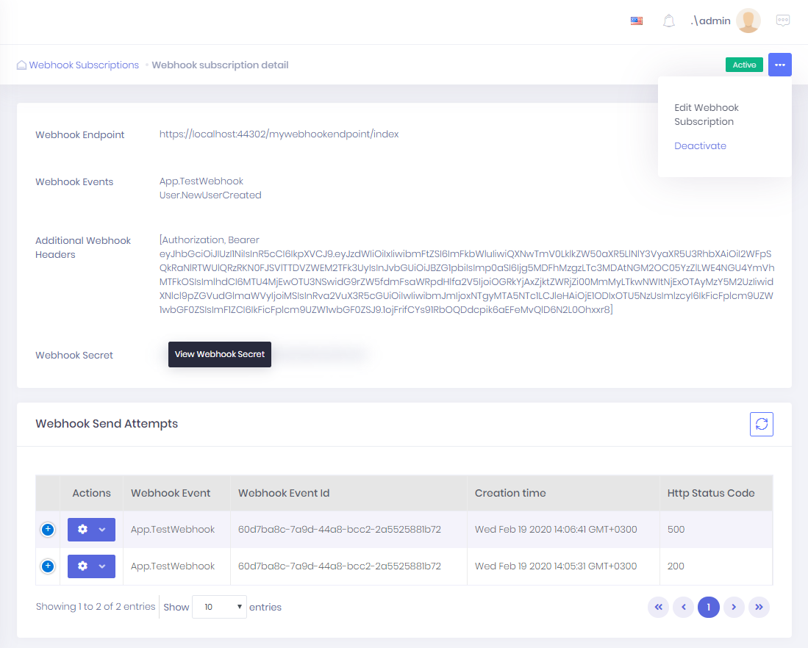
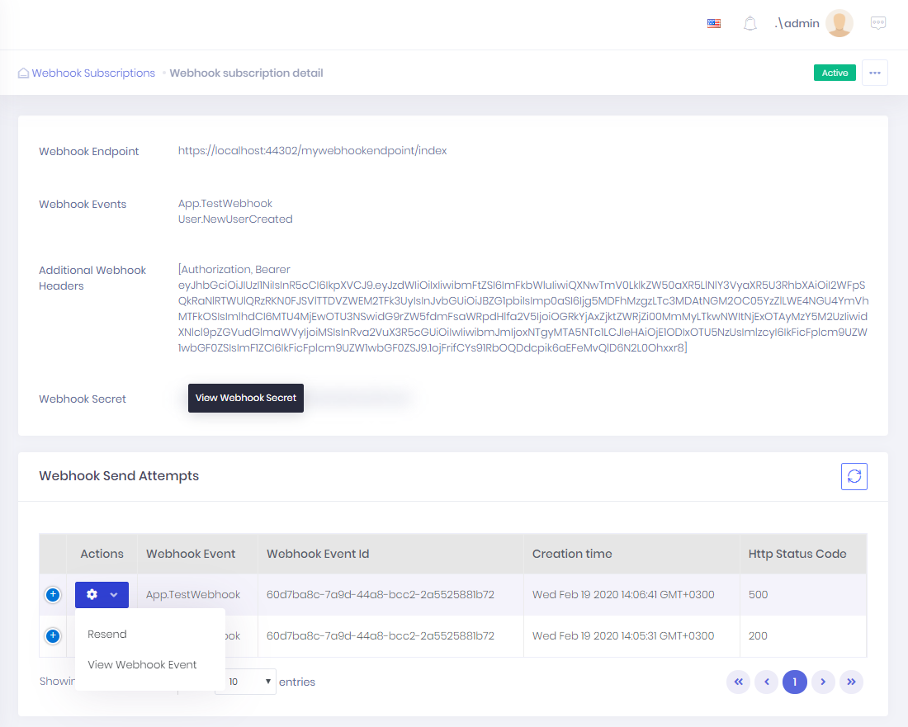
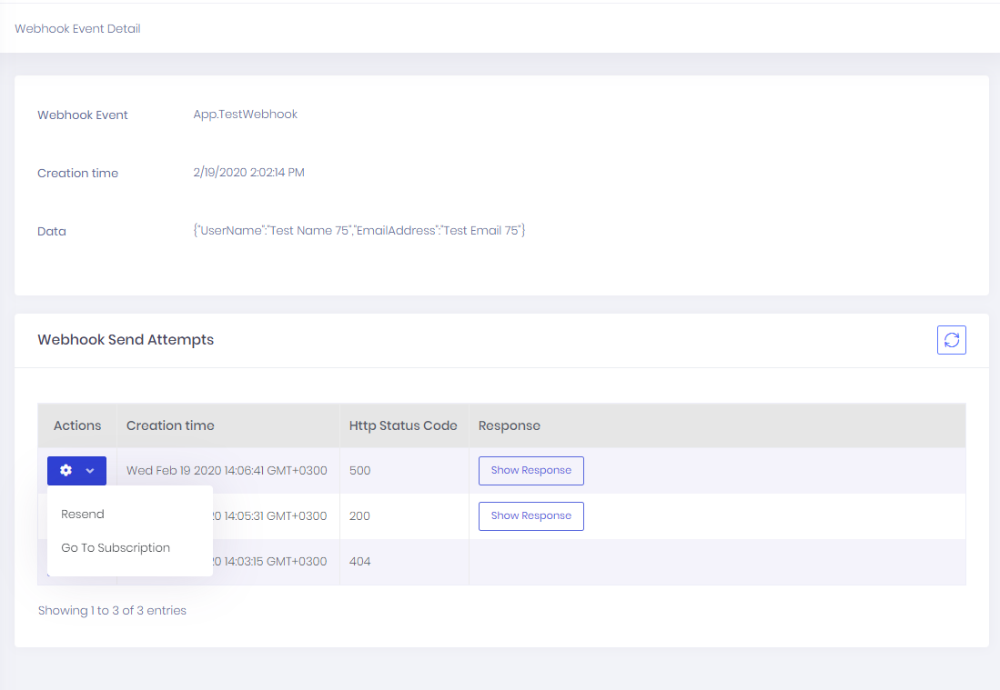
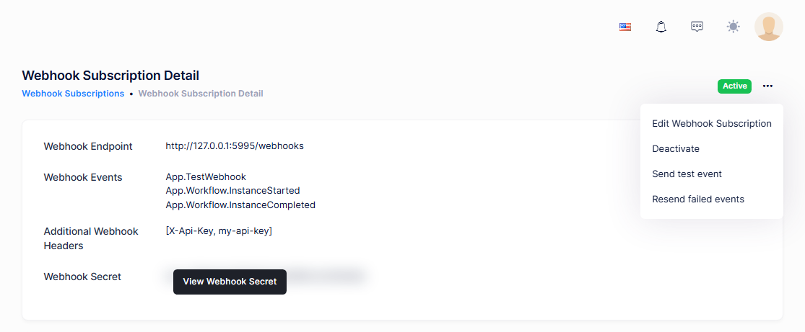
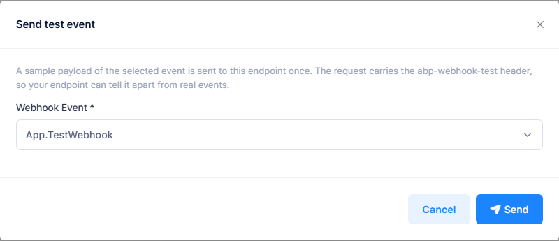
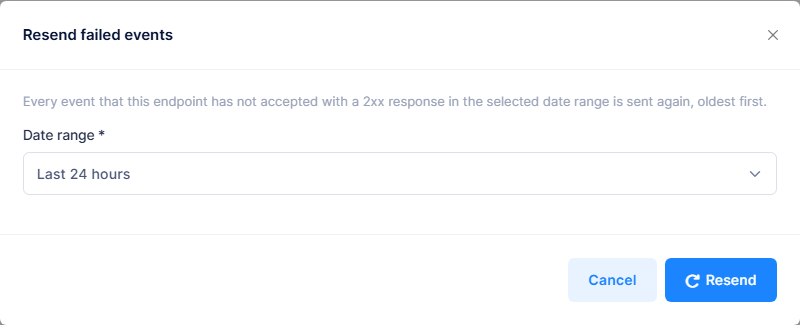

# Webhooks

ASP.NET ZERO has built-in webhook system designed with pub/sub pattern. 

In **Webhook Subscriptions** page, you can see all of your webhook subscriptions:

You can click a row to see detail of a subscription.

In **Webhook Subscription Detail** page, you can edit, activate or deactivate a subscription. You can also see all webhook send attempts that your subscription received. 

You can resend a webhook with same parameter or view webhook event.

In  **Webhook Event Detail** page, you can see the detail of a created webhook. And you can see all send attempts for all of your subscriptions.

For more information. You can check [ASP.NET Boilerplate webhook documentation](https://aspnetboilerplate.com/Pages/Documents/Webhook-System).

### Sending a Test Event

Use **Send test event** in the actions menu of the subscription detail page to check an endpoint without waiting for a real event. Select `App.TestWebhook` for a simple ping, or one of the events the subscription receives to get a sample payload of that event. The test is sent once, without retries, and its result appears in the send attempts list like any other attempt. It also works for an inactive subscription.

A test request carries the `abp-webhook-test: true` header, so your endpoint can ignore it instead of acting on sample data. The body has the same shape and signature as a real webhook.

The sample payloads are created by `WebhookTestPayloadProvider` in the `Core` project. If you add your own webhook definitions, add a sample for them there; until then, they get a generic test payload.

This action requires the `Pages.Administration.WebhookSubscription.SendTestWebhook` permission.

### Resending Failed Events

When an endpoint was down for a while, use **Resend failed events** in the actions menu instead of resending attempts one by one. Select a date range, and every event that this endpoint has not accepted with a 2xx response in that range is sent again, oldest first. An event that failed a few times and then succeeded is not resent.

- Each event is sent once, without retries. Failed resends are listed as new send attempts.
- Up to 500 events are queued in one run (`AppWebhookConsts.MaxFailedEventResendCount`). If more failed, the result tells you how many were left; run it again after the queued ones are delivered.
- The subscription must be active.

An event can arrive more than once: the original send may still be retrying, or you may resend it again. The `Id` in the payload is the id of the webhook event and stays the same on every resend, so use it to ignore duplicates on your endpoint.

This action requires the `Pages.Administration.Webhook.ResendWebhook` permission, the same one used to resend a single attempt.

## Next

- [Rate Limiting](Features-Rate-Limiting)