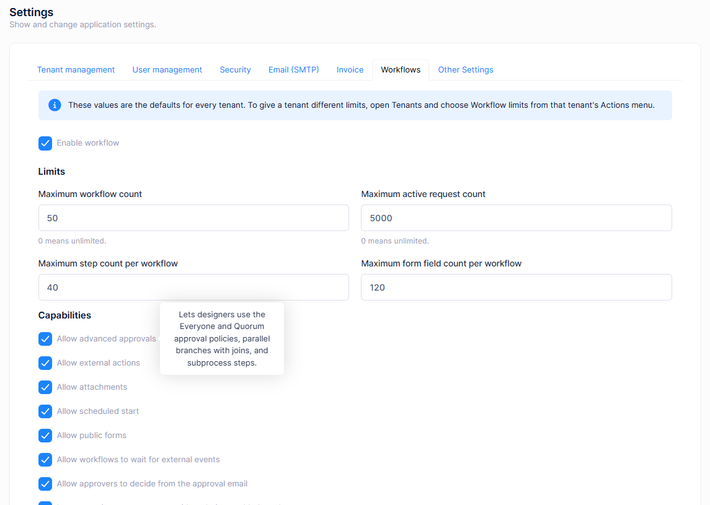

# Workflow Administration

This document describes how workflows are configured by the host and by each tenant, the permissions involved, and the pages used to monitor requests.

## Host settings

Host administrators configure workflows in **Administration > Settings > Workflows**. These values are the defaults for every tenant.

### Enabling workflows

**Enable workflow** turns the feature on or off. It is on by default. When it is off, the workflow menus are hidden in every tenant.

### Limits

| Setting | Description |
|---|---|
| **Maximum workflow count** | How many workflow definitions a tenant can have. `0` means unlimited. |
| **Maximum active request count** | How many requests can be in progress at the same time. `0` means unlimited. |
| **Maximum step count per workflow** | The step limit shown in the designer as **Steps N / max**. |
| **Maximum form field count per workflow** | The field limit of the form builder. |

To give a tenant different limits, open **Tenants** and choose **Workflow limits** from that tenant's **Actions** menu.

### Capabilities

Capabilities turn optional parts of the feature on or off. Hover over a capability's label on the settings page to see a short description.

| Capability | Default | What it enables |
|---|---|---|
| **Allow advanced approvals** | On | The **Everyone must approve** and **A quorum must approve** decision policies, Parallel and Join steps, and Subprocess steps. |
| **Allow external actions** | Off | The Action step, which calls registered actions, webhooks and HTTP connection profiles. |
| **Allow attachments** | On | Attachment form fields and file uploads on requests, including public forms. |
| **Allow scheduled start** | Off | The **Scheduled** trigger. Turning it off stops existing schedules. |
| **Allow public forms** | Off | The **Public form** trigger. Turning it off stops existing public form links. |
| **Allow workflows to wait for external events** | Off | The Wait for event step and the **Workflow events** page. |
| **Allow approvers to decide from the approval email** | Off | Approve and reject links in approval emails. Tenants can also change this in their own **Workflow Settings**. |
| **Let new action connectors run without being enabled one by one** | On | Makes every registered action connector available to tenants unless a tenant turns it off in **Action catalog**. |
| **Collect process analytics** | On | Background metric collection and the **Process analytics** page. |
| **Show per-reviewer analytics** | Off | Analytics per approver. Requires process analytics and the **Reviewer analytics** permission. |
| **Allow running requests to be migrated to a newer version** | Off | **Version migration** of running requests. |
| **Allow workflows to be exported as BPMN 2.0** | On | **Export as BPMN**. |
| **Allow workflows to be imported from BPMN 2.0** | Off | **Import from BPMN**. |
| **Elsa workflow JSON import and export** | Off | **Export as Elsa JSON** and Elsa import. |
| **Allow AI to draft workflows** | Off | **Describe and create** and AI suggestions in the designer. An AI service must be configured; choose it in the settings that appear when this is on. |

### Host pages

The host's **Workflows** menu has two pages:

- **Workflow Health** shows workflow throughput across every tenant without opening any tenant's business data. It also warns about deployment problems, such as a missing encryption key for workflow secrets.
- **Workflow AI usage** shows AI calls and tokens across every tenant. Pick a tenant to see its AI agents one by one.

## Workflow Settings

Each tenant configures its own workflow behaviour in **Workflows > Workflow Administration > Workflow Settings**.

| Tab | Settings |
|---|---|
| **Business calendar** | **Timezone**, **Business days**, **Business day start hour**, **Business day end hour** and **Holidays**. Used by due dates, reminders, escalations and timers that use the business calendar. |
| **Approvals** | **Default self approval policy**: **Do not allow self approval** (default), **Allow self approval** or **Skip the step for the requester**. **Allow workflow actions during impersonation**. |
| **Retention** | **History retention period (days)** and **Send a daily reminder digest**. |
| **Attachments** | **Allowed attachment file extensions**, **Maximum attachment size (bytes)** and **Keep the values of hidden form fields**. |
| **Channels** | Where notifications are delivered outside the application: deciding from the approval email (with **Approval link lifetime (hours)** and **Require a reason when deciding from email**), Microsoft Teams, Slack, deciding from a chat card, and the connection profiles they use. Requires **Managing decision channels**. |
| **Edition limits** | The tenant's usage of its workflow and active request limits. |

Users with **Linking chat accounts** also see **Connected chat accounts**, where they can link the chat accounts of people who cannot link their own.

## Permissions

Workflow permissions are tenant permissions, granted in **Administration > Roles** or per user. The tenant's **Admin** role has all of them by default. Other roles, including the default **User** role, have none.

| Permission | Allows |
|---|---|
| **Workflows** | The parent of every workflow permission. |
| Workflow Requests | **My Requests**. |
| Workflow Requests > **Starting workflow requests** | Starting requests from the **Request Catalog**. |
| Workflow Requests > **Withdrawing workflow requests** | Withdrawing your own requests. |
| Approval Inbox | Seeing your tasks in **Approval Inbox**. |
| Approval Inbox > **Acting on workflow tasks** | Approving, rejecting and requesting changes. |
| Workflow Delegations | **Workflow Delegations**. |
| Workflow Definitions | Listing workflow definitions. |
| Workflow Definitions > **Creating / Editing / Publishing / Retiring workflow definitions** | Managing definitions in the designer. |
| Workflow Definitions > **Managing public forms**, **Managing scheduled starts** | Public form and scheduled triggers. |
| Workflow Definitions > **Exporting workflows to BPMN**, **Importing workflows from BPMN** | BPMN exchange. |
| Workflow Templates | **Workflow Templates**. |
| Workflow Instances, > **Operating workflow instances**, > **Migrating running requests** | **Workflow Instances**, **Workflow Operations** and version migration. |
| Workflow Audit, > **Exporting workflow audit** | **Workflow Audit**. |
| Process analytics, > **Reviewer analytics**, **Exporting process analytics**, **Rebuilding process analytics** | **Process analytics**. |
| Workflow Settings, > **Managing decision channels**, > **Linking chat accounts**, > **Connection profiles** | **Workflow Settings** and its channel settings. |
| Workflow secrets, Action catalog, Events, AI agents, AI proposals, AI usage | The pages of the optional features. |

A typical setup:

| Role | Permissions |
|---|---|
| Employees | Starting workflow requests, Withdrawing workflow requests |
| Approvers | Acting on workflow tasks, Workflow Delegations |
| Process owners | Workflow Definitions and its children, Workflow Templates, Workflow Instances, Process analytics |

## Monitoring

The monitoring pages are under **Workflows > Workflow Administration**.

| Page | Description |
|---|---|
| **Workflow Instances** | Every request that has been started, with its current step and status. Open one to see its path through the flow, its tasks and its history. |
| **Workflow Operations** | The **Operations Dashboard**. Intervene in stuck requests, retry failed steps and watch the health of background processing. Requires **Operating workflow instances**. |
| **Workflow Audit** | The **Workflow Audit Trail**. Search every workflow action for compliance and reporting, and export it. |
| **Process analytics** | How long processes take, where they stall and which steps need attention, including a heat map on the flow. Metrics are collected in the background, so new data can take a while to appear. |

## Optional features

These pages appear when the related capability is enabled by the host and the user has the permission:

| Page | Description |
|---|---|
| **Workflow events** | Defines the external events that the Wait for event step waits for. |
| **Action catalog** | Lists the action connectors and turns them on or off for the tenant. |
| **Connection profiles** | Endpoints used by HTTP actions and chat channels. |
| **Workflow secrets** | Encrypted values, such as API keys, referenced by connection profiles and AI agents. Values are never shown again after saving. |
| **AI agents**, **AI proposals**, **AI usage** | Configure the AI agents used by AI agent steps, review AI suggestions, and see the calls made and tokens spent by AI agents and the designer assistant. |

## Next

- [Workflows overview](Features-Workflows)
