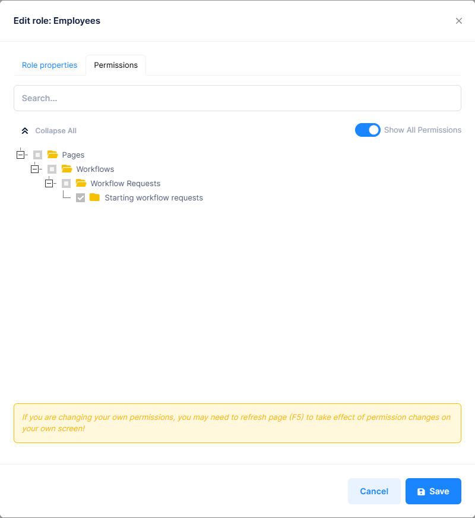
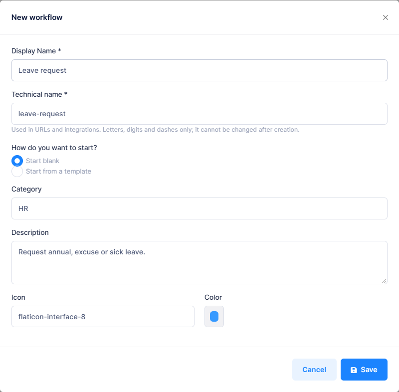
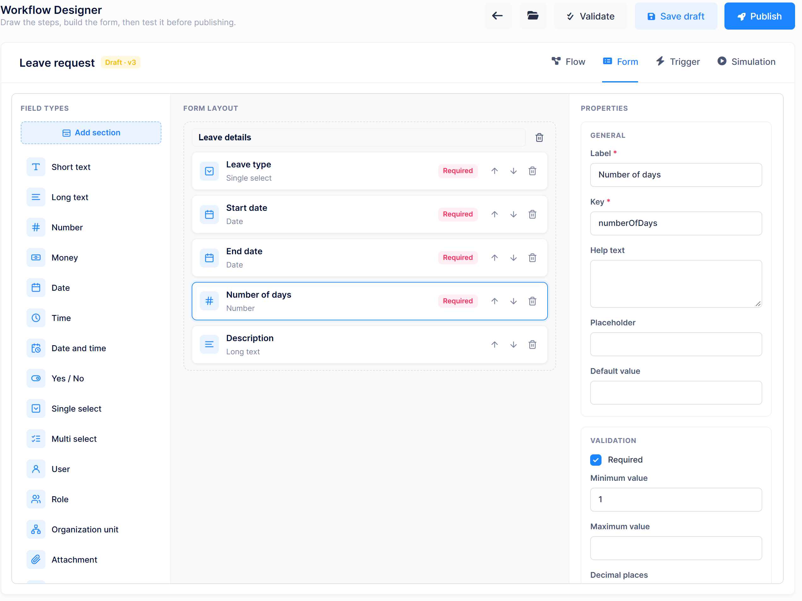
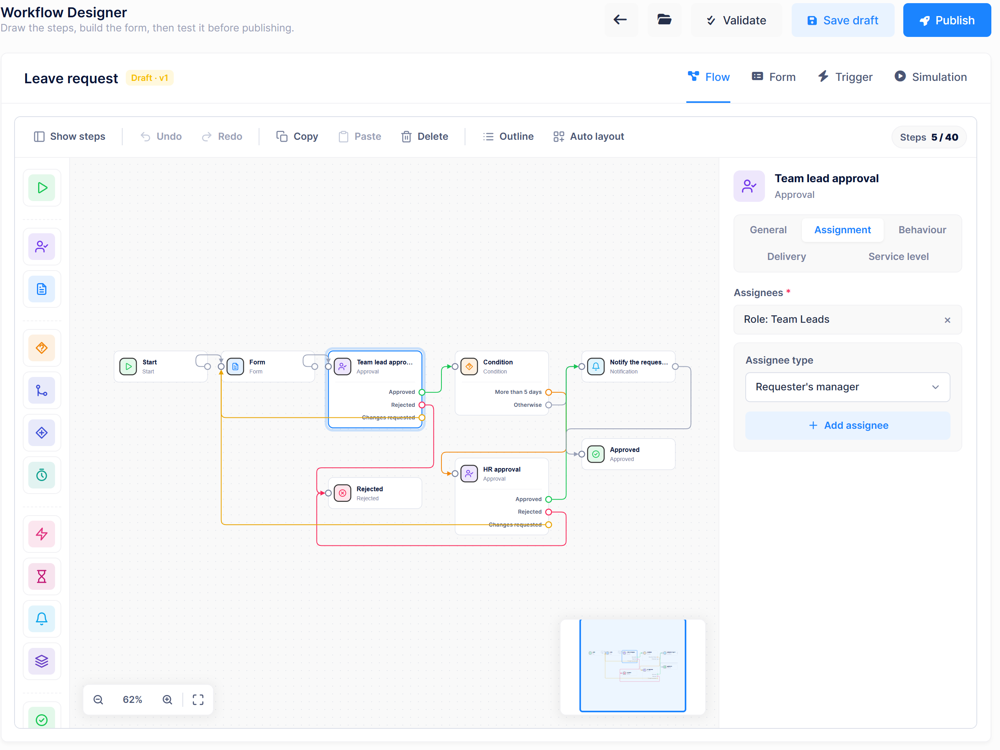
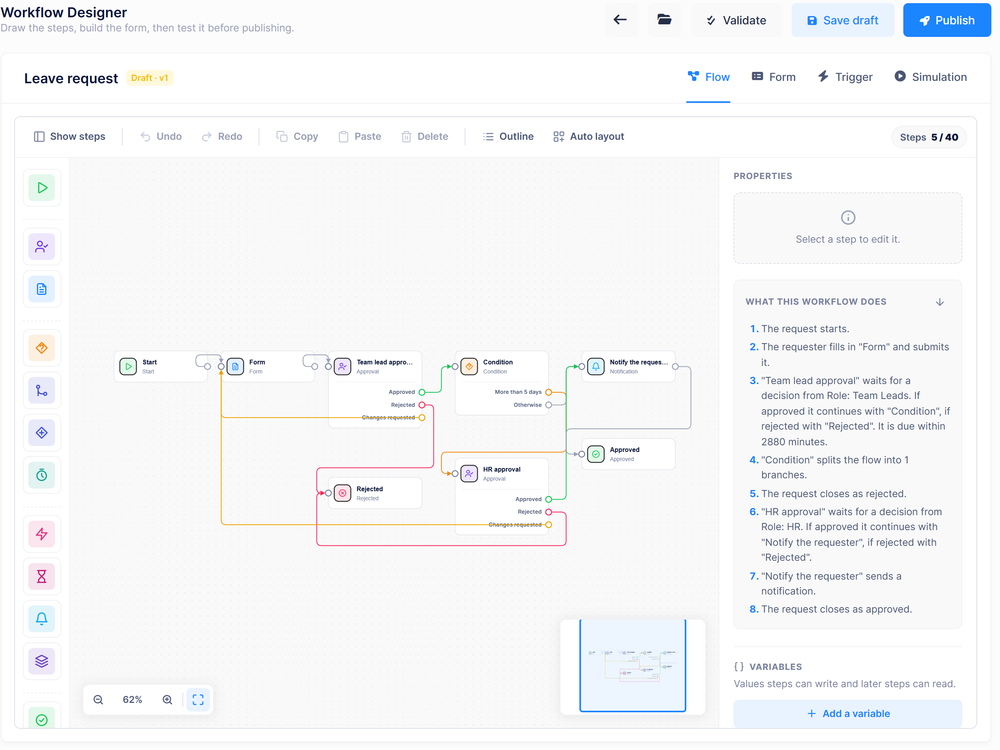
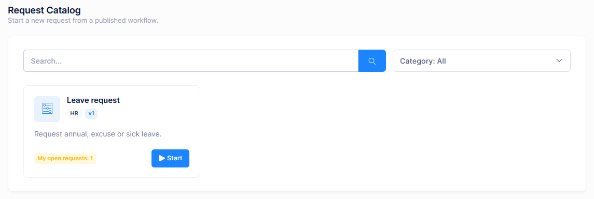
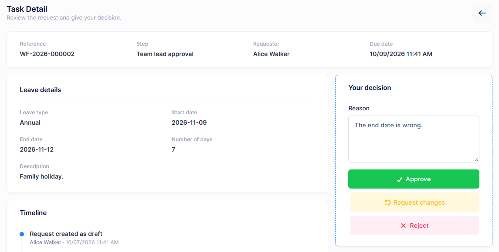
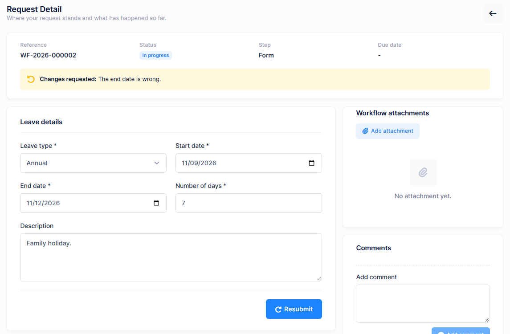
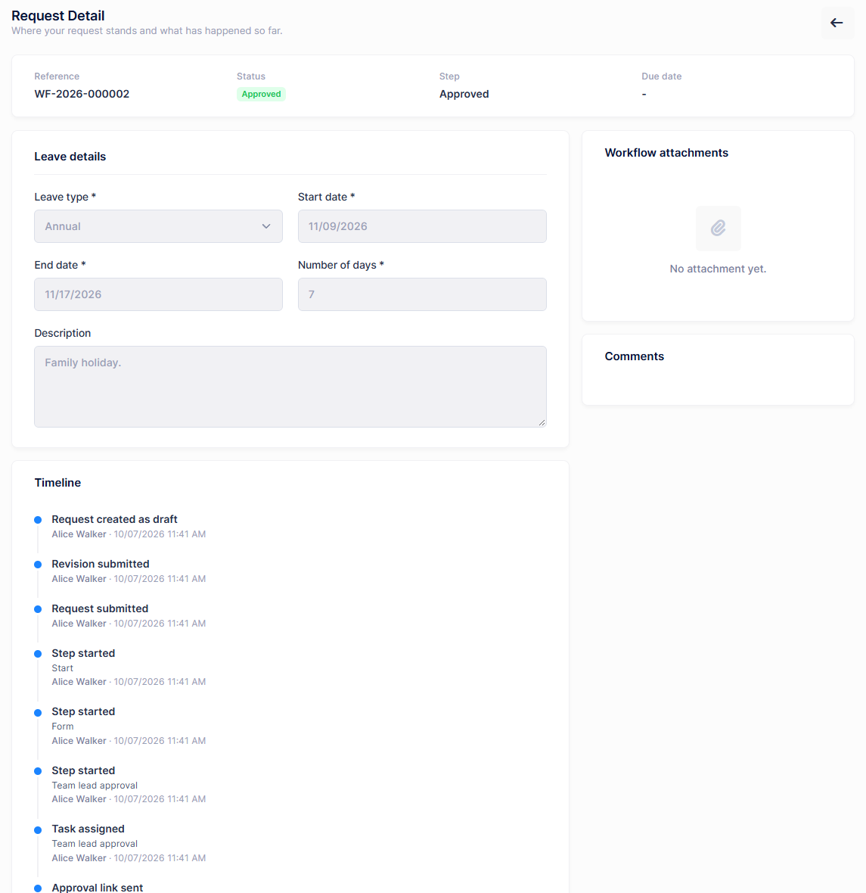

# Create Your First Workflow

This tutorial builds a **leave request** workflow from scratch, publishes it and runs it end to end. It takes about 30 minutes and covers the parts of the feature you will use most: the form builder, approval steps, a condition, a notification, publishing, and deciding on requests.

## The scenario

Employees request leave in the application instead of by e-mail.

- Every request is approved by a **team lead**.
- Requests for **more than 5 days** are also approved by **HR**.
- An approver who spots a mistake can send the request **back to the requester for changes** instead of rejecting it.
- The employee is notified when the leave is approved.

You will use four users:

| User | Role | Purpose |
|---|---|---|
| `admin` | Admin | Designs and publishes the workflow |
| `alice` | Employees | Requests leave |
| `bob` | Team Leads | Team lead approval |
| `carol` | HR | HR approval |

The finished flow looks like this:

```
Start → Form → Team lead approval
                 ├─ Approved ──────────→ Condition
                 │                         ├─ More than 5 days → HR approval
                 │                         │                       ├─ Approved ──────────→ Notification → Approved
                 │                         │                       ├─ Rejected ──────────→ Rejected
                 │                         │                       └─ Changes requested ─→ back to Form
                 │                         └─ Otherwise ────────────────────────────────→ Notification → Approved
                 ├─ Rejected ──────────→ Rejected
                 └─ Changes requested ─→ back to Form
```

> The team lead approval in this tutorial is assigned to a **role**. The approval step also offers **Requester's manager**, which sends each request to the requester's own manager, but this needs manager relationships to be stored for your users first. See [Assignees](Features-Workflows-Designer#assignees).

## Step 1: Prepare roles and users

Log in to a tenant as `admin`. Workflows must be enabled by the host, which is the default. See [Workflow Administration](Features-Workflows-Administration#host-settings).

1. Go to **Administration > Roles** and create three roles. In the permission tree of each role, grant:

   | Role | Permissions |
   |---|---|
   | **Employees** | Workflows > Workflow Requests > **Starting workflow requests** |
   | **Team Leads** | Workflows > Approval Inbox > **Acting on workflow tasks** |
   | **HR** | Workflows > Approval Inbox > **Acting on workflow tasks** |

   Granting a permission also grants its parents, so **Workflows**, **Workflow Requests** and **Approval Inbox** are selected automatically.

2. Go to **Administration > Users** and create `alice`, `bob` and `carol`, assigning each the role in the table above.

> An approver needs **Acting on workflow tasks**. With only **Approval Inbox**, the user sees their tasks but cannot decide on them.

> By default, nobody can approve their own request. Use separate users for the requester and the approvers, and log in to each in a separate browser or private window.



## Step 2: Create the workflow

1. Go to **Workflows > Workflow Administration > Workflow Definitions** and click **New workflow**.
2. Fill in the dialog:
   - **Display Name**: `Leave request`
   - **Technical name**: filled in from the display name, for example `leave-request`. It may only contain lowercase letters, digits and hyphens, and cannot be changed later.
   - **How do you want to start?**: **Start blank**
   - **Category**: `HR`
3. Click **Save**.

The **Workflow Designer** opens with an empty canvas. It has four tabs: **Flow**, **Form**, **Trigger** and **Simulation**.



## Step 3: Build the form

Open the **Form** tab. Click a field type in the **Field types** list to add it to the form, then set its properties in the **Properties** pane. Add these fields:

| Label | Field type | Key | Properties |
|---|---|---|---|
| Leave type | Single select | `leaveType` | **Options**: `Annual`, `Excuse`, `Sick` (one per line). **Required** |
| Start date | Date | `startDate` | **Required** |
| End date | Date | `endDate` | **Required** |
| Number of days | Number | `numberOfDays` | **Required**, **Minimum value** `1` |
| Description | Long text | `description` | |

The **Key** identifies the field in conditions and integrations. Keep it short and stable. All fields go into one section; the screenshot below titles it **Leave details**.

Requesters can still attach files, such as a medical report, from the **Workflow attachments** section of the request page.



## Step 4: Draw the flow

Open the **Flow** tab. The **Steps** palette on the left groups the step types. Click a step to add it to the canvas, or drag it onto the canvas. Select a step to edit it in the **Properties** panel on the right.

To connect two steps, drag from an **output port** (the circle on the right of a step, or the labeled row under it) to the **input port** of the next step (the circle on its left).

### 4.1 Add the steps

Add the following steps and rename them in the **General** tab of the **Properties** panel where shown:

| Palette group | Step | Name |
|---|---|---|
| Flow | Start | |
| Human tasks | Form | |
| Human tasks | Approval | `Team lead approval` |
| Control | Condition | |
| Human tasks | Approval | `HR approval` |
| Integration | Notification | `Notify the requester` |
| Outcomes | Approved | |
| Outcomes | Rejected | |

### 4.2 Configure the team lead approval

Select **Team lead approval**.

1. On the **Assignment** tab, under **Assignees**, choose **Role** as the assignee type, pick **Team Leads** and click **Add assignee**.
2. On the **Behaviour** tab, keep the defaults:
   - **Decision policy**: **Anyone can decide**. One team lead deciding is enough.
   - **Allow "request changes"**: on.
   - **Require a reason when rejecting**: on.
3. Optionally, on the **Service level** tab set **Due in (minutes)** to `2880` (two days) and **Reminder every (minutes)** to `1440`.



### 4.3 Configure the condition

Select the **Condition** step and click **Add branch**. In the branch editor:

- **Branch name**: `More than 5 days`
- **Field**: **Number of days**
- **Operator**: **Greater than**
- **Value**: `5`

The step now has two outputs: **More than 5 days** and **Otherwise**. The **Otherwise** output is taken when no branch matches, and it must be connected.

### 4.4 Configure the HR approval

Select **HR approval**. On the **Assignment** tab, add the **Role** **HR** as the assignee. Keep the other defaults.

### 4.5 Configure the notification

Select **Notify the requester**.

1. On the **General** tab:
   - **Notification name**: `LeaveApproved`
   - **Subject**: `Your leave request was approved`
   - **Message**: `Your request {businessReference} for {workflowName} was approved.`
2. On the **Delivery** tab, keep **Send as an in-app notification** on. Turn on **Also send an e-mail** if e-mail is configured.
3. On the **Recipients** tab, tick **The requester**.

The Subject and Message can contain placeholders in single braces, such as `{workflowName}` and `{businessReference}`. See [Notification](Features-Workflows-Designer#notification).

### 4.6 Connect the steps

Draw these connections:

| From step | Output | To step |
|---|---|---|
| Start | | Form |
| Form | | Team lead approval |
| Team lead approval | Approved | Condition |
| Team lead approval | Rejected | Rejected |
| Team lead approval | Changes requested | Form |
| Condition | More than 5 days | HR approval |
| Condition | Otherwise | Notify the requester |
| HR approval | Approved | Notify the requester |
| HR approval | Rejected | Rejected |
| HR approval | Changes requested | Form |
| Notify the requester | | Approved |

Drag the steps to arrange the diagram, or click **Auto layout** in the canvas toolbar to line them up automatically.

> Connecting **Changes requested** back to **Form** is required while **Allow "request changes"** is on. It is how a request returns to the requester for corrections.



## Step 5: Validate, test and publish

1. Click **Validate**. When the flow is complete you see **No problems found. The workflow is ready to publish.** Otherwise, a list shows each problem with the name of the step it belongs to. Fix them and validate again.
2. Optional but recommended: open the **Simulation** tab.
   - **Requester**: `alice`
   - **Decisions per approval**: **Approve** for both approvals
   - **Sample form values**: **Number of days** = `7`
   - Click **Run simulation**. The result shows the path **Team lead approval → HR approval → Notify the requester → Approved**, with the assignees of each step. Run it again with `3` days and the HR approval is skipped.
3. Click **Save draft**.
4. Click **Publish** and confirm. **Publish** is only enabled when there are no unsaved changes, so always save first.

The workflow now appears in **Workflow Definitions** with the status **Active** and version **v1**. It is listed in the **Request Catalog** for everyone who can start requests.

## Step 6: Run the workflow

### Alice requests seven days of leave

1. Log in as `alice` and go to **Workflows > Start a Request**.
2. Click **Start** on the **Leave request** card. A draft request opens.

   

3. Fill in the form: **Annual**, a start and end date, **Number of days** = `7`. Click **Submit**.
4. The request is listed under **Workflows > My Requests**.

### Bob asks for a correction

1. Log in as `bob`. A notification says a task was assigned. Go to **Workflows > Approval Inbox** and open the request.
2. The page shows the form values, the **Timeline** and the **Your decision** card. Enter `The end date is wrong` as the **Reason** and click **Request changes**.



### Alice corrects the request

1. As `alice`, open the request from **My Requests**. A **Changes requested** alert shows Bob's reason.
2. Correct the end date and click **Resubmit**.



### Bob and Carol approve

1. As `bob`, open the task again and click **Approve**. Because 7 is greater than 5, the request moves to HR.
2. Log in as `carol`. The task is in **Approval Inbox**. Open it and click **Approve**.
3. The request is closed as **Approved** and Alice receives the "Your leave request was approved" notification.

Open the request as `alice` and look at its **Timeline**: it lists every submission and decision with the person and the reason.



### Try the other paths

- **A short leave:** Alice requests `3` days. After Bob approves, the request is approved directly and Carol never sees it.
- **A rejection:** Bob clicks **Reject**. A reason is required, and the request is closed as **Rejected**.

## Next steps

- Change the workflow: open it in the designer, edit and publish again. The new version is used for new requests only. See [Versions](Features-Workflows-Designer#drafts-versions-and-publishing).
- Let Bob hand their tasks to a colleague during a holiday with [Workflow Delegations](Features-Workflows-Requests-And-Approvals#delegations).
- Save the workflow as a template with the **Save as template** button so others can start from it.
- Follow your requests in **Workflow Instances** and **Process analytics**. See [Workflow Administration](Features-Workflows-Administration#monitoring).

## Next

- [Workflow Designer](Features-Workflows-Designer)
