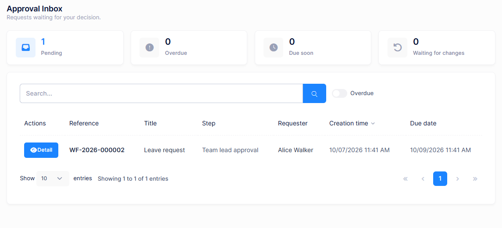

# Requests and Approvals

This document describes the workflow pages used every day by employees and approvers. All of them are under the **Workflows** menu.

| Page | Used by | Permission |
|---|---|---|
| **Start a Request** | Requesters | Workflow Requests > Starting workflow requests |
| **My Requests** | Requesters | Workflow Requests |
| **Approval Inbox** | Approvers | Approval Inbox > Acting on workflow tasks |
| **Workflow Delegations** | Approvers | Workflow Delegations |

## Starting a request

**Workflows > Start a Request** opens the **Request Catalog**, which lists every published workflow that accepts new requests. Use the search box or the **Category** filter to find one.

1. Click **Start** on a workflow card. A draft request is created and its page opens. A **My open requests** badge on the card shows how many of your requests for that workflow are still open.
2. Fill in the form. Use **Save draft** to continue later.
3. Click **Submit**. If a field is invalid, the form shows **Please correct the highlighted fields.**

Every user with the start permission sees every published workflow in the catalog. To stop new requests for a workflow, an administrator chooses **Suspend new requests** or **Retire** on the **Workflow Definitions** page.

## Following your requests

**Workflows > My Requests** lists the requests you started with their **Reference**, **Title**, **Workflow**, **Status**, current **Step** and **Creation time**. Open a request to see its page:

| Section | Description |
|---|---|
| Header | **Reference**, **Status**, current **Step** and **Due date** |
| Form | The values you submitted. Editable while the request is a draft or when changes are requested. |
| **Timeline** | Every submission, decision, reminder and escalation, with who and when |
| **Workflow attachments** | Files attached to the request. Use **Add attachment** to add more, if the step allows it. |
| **Comments** | A conversation with the approvers. Use **Add comment**. |

The buttons depend on the state of the request:

| Button | When |
|---|---|
| **Save draft**, **Submit** | The request is a draft. |
| **Resubmit** | An approver requested changes. A **Changes requested** alert shows their reason. |
| **Withdraw** | The request is in progress and the step allows withdrawal. Withdrawing cancels its pending tasks. Requires **Withdrawing workflow requests**. |

## Deciding on tasks

**Workflows > Approval Inbox** lists the requests waiting for your decision.

- The cards at the top count **Pending**, **Overdue**, **Due soon** and **Waiting for changes** tasks. The **Overdue** switch filters the list.
- The list shows the **Reference**, **Title**, **Step**, **Requester**, **Creation time** and **Due date**. Badges mark tasks that are **Delegated**, **Escalated**, **Overdue** or **Due soon**.

Click **Detail** to open a task. The page shows the request's form, timeline, attachments and comments, and the **Your decision** card:

| Button | Result |
|---|---|
| **Approve** | The request continues on the step's **Approved** path. With **Everyone must approve** or **A quorum must approve**, it continues once enough approvers have approved. |
| **Reject** | The request continues on the **Rejected** path, which usually closes it. |
| **Request changes** | The request goes back to the requester, who corrects it and resubmits. Only shown when the step allows it. |

Enter a **Reason** to explain your decision. The workflow designer decides when a reason is required; by default it is required when rejecting. Without one, you see **A reason is required for this decision.**

> To decide, an approver needs **Acting on workflow tasks** in addition to **Approval Inbox**.

> By default you cannot approve a request you started yourself. The tenant's **Default self approval policy** in **Workflow Settings** controls this.

### Deciding outside the application

When enabled by the host and the tenant, approvers can also decide:

- **From the approval email.** The email contains approve and reject links. Opening a link shows a confirmation screen, and the decision is recorded only after it is confirmed. The links expire after the **Approval link lifetime** set in **Workflow Settings**.
- **From a Microsoft Teams or Slack card**, when the approval step delivers to a chat channel and allows deciding from the chat message. Each approver first links their chat account under **My settings > Connected chat accounts**.

## Notifications

Requesters and approvers receive in-app notifications when a task is assigned, reassigned or completed, before and after it becomes due, when it is escalated or delegated, when changes are requested, and when the request is approved, rejected or cancelled. The **Notification** step of a workflow can send additional notifications and e-mails.

If the tenant turns on **Send a daily reminder digest** in **Workflow Settings**, approvers also receive a daily summary of their open tasks.

## Delegations

**Workflows > Workflow Delegations** lets an approver hand their tasks to a colleague for a period of time, for example during a holiday.

1. Click **Create delegation**.
2. Search for the colleague and select them in **Delegated to**.
3. Set the **Start date** and **End date**, optionally enter a **Reason**, and click **Save**.

While the delegation is active, the colleague sees your tasks from approval steps that allow delegation in their own **Approval Inbox**, marked with a **Delegated** badge, and can decide on them on your behalf. The tasks stay assigned to you. A delegation created from this page applies to all workflows.

The list can be filtered with **Delegated by me** or **Delegated to me** and **Only active**. Its **Status** column shows **Not started yet**, **Active**, **Ended** or **Revoked**. Use **Revoke** to end a delegation early.

## Next

- [Workflow Administration](Features-Workflows-Administration)
