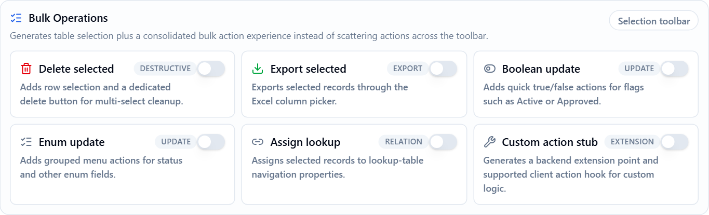

# Power Tools Bulk Operations

Power Tools can generate **bulk operations** for an entity, so users can act on many records at once from the generated list page. Bulk operations are available in the Angular, React and MVC UIs, for the **DataTable**, **Card View** and **Master Detail** page templates.

## Enabling Bulk Operations

Open your entity in the Power Tools web UI and go to the **Entity Information** step. The **Bulk Operations** section lists an option for each operation. All of them are off by default, so you only generate what the entity needs.



| Option | What it adds | Requires | Permission |
|---|---|---|---|
| **Delete selected** | A **Delete selected** button. | | `Delete` |
| **Export selected** | Exports the selected records through the Excel column picker. | **Create Excel Export Button** | Page permission |
| **Boolean update** | Actions that set a boolean property to true or false. | A `bool` property | `Edit` |
| **Enum update** | Actions that set an enum property to one of its values. | An enum property | `Edit` |
| **Assign lookup** | An action that assigns the selected records to a value of a navigation property. | A navigation property with the `LookupTable` view type | `Edit` |
| **Custom action stub** | An empty server method and a client action for your own logic. | | `Edit` |

An option is ignored when the entity does not meet its requirement. For example, **Boolean update** generates nothing for an entity without a `bool` property.

After changing the options, generate the entity again.

## Using Bulk Operations

The generated list page adds row selection, and the actions appear once records are selected:

- **Delete selected** appears when more than one record is selected.
- The other actions are grouped under a **Bulk actions** menu.

The page acts on the selected records by default. If the current filter matches more records than are selected, a message shows **Apply to {0} selected records** with an **Apply to all {0} filtered records** link. This link extends the action to **every record that matches the current filter**, including the records on other pages.

## Generated Server Code

Each operation adds a method to the generated application service:

| Option | Method | Input class |
|---|---|---|
| **Delete selected** | `DeleteBulk` | `BulkDelete{Entities}Input` |
| **Export selected** | `GetSelected{Entities}ToExcel` | `BulkExport{Entities}Input` |
| **Boolean update** | `BulkUpdateBoolean` | `BulkUpdate{Entities}BooleanInput` |
| **Enum update** | `BulkUpdateEnum` | `BulkUpdate{Entities}EnumInput` |
| **Assign lookup** | `BulkAssignLookup` | `BulkAssign{Entities}LookupInput` |
| **Custom action stub** | `CustomBulkAction` | `BulkCustomAction{Entities}Input` |

All input classes have these properties:

| Property | Description |
|---|---|
| `Ids` | The ids of the selected records. Required when `SelectAllFiltered` is `false`. |
| `SelectAllFiltered` | Set `true` to act on every record that matches `Filter`. |
| `Filter` | The same filter input as the list page. Required when `SelectAllFiltered` is `true`. |

The update and assign inputs also have `PropertyName` and `Value`. `PropertyName` is checked against a list of the entity's generated properties, and any other name is rejected. The export input also has `SelectedColumns`.

For example, this is the method generated for a `Product` entity:

```csharp
[AbpAuthorize(AppPermissions.Pages_Products_Delete)]
[HttpPost]
public virtual async Task DeleteBulk(BulkDeleteProductsInput input)
{
    var query = _productRepository.GetAll();

    if (input.SelectAllFiltered)
    {
        query = ApplyFilters(query, input.Filter);
    }
    else
    {
        var ids = input.Ids.Distinct().ToList();
        query = query.Where(e => ids.Contains(e.Id));
    }

    await query.ExecuteDeleteAsync();
}
```

The queries start from the repository, so tenant and soft delete filters still apply.

## How Records Are Changed

Bulk operations are designed to work on many records efficiently. Some of them therefore run directly in the database instead of loading each entity:

| Operation | How it runs | Result |
|---|---|---|
| **Boolean update**, **Enum update**, **Assign lookup** | `ExecuteUpdateAsync` | Entities are not loaded. |
| **Delete selected**, `FullAuditedEntity` base class | Loads the records and calls `DeleteAsync` for each one | Records are soft deleted. This takes longer for a large number of records. |
| **Delete selected**, other base classes | `ExecuteDeleteAsync` | Records are permanently deleted. Entities are not loaded. |

> When entities are not loaded, Entity Framework Core does not track the change. Entity events are not triggered, audit fields such as `LastModificationTime` are not updated, and the change does not appear in entity history. If your entity relies on these, override the method and change the entities one by one.

## Adding Your Own Bulk Action

**Custom action stub** generates a `CustomBulkAction` method that resolves the selected or filtered records and leaves the rest to you:

```csharp
[AbpAuthorize(AppPermissions.Pages_Products_Edit)]
[HttpPost]
public virtual async Task CustomBulkAction(BulkCustomActionProductsInput input)
{
    var query = _productRepository.GetAll();

    if (input.SelectAllFiltered)
    {
        query = ApplyFilters(query, input.Filter);
    }
    else
    {
        var ids = input.Ids.Distinct().ToList();
        query = query.Where(e => ids.Contains(e.Id));
    }

    // TODO: Implement custom bulk action logic.
    await Task.CompletedTask;
}
```

The generated application service is overwritten when you regenerate the entity. To keep your logic, turn on **Generate Overridable Entity** and override the method in `ProductsAppService.Extended.cs`, which Power Tools never overwrites. All bulk methods are `virtual`, so you can override the other operations in the same way. See [Custom Code - Angular](Power-Tools-Custom-Code-Angular.md), [Custom Code - React](Power-Tools-Custom-Code-React.md) or [Custom Code - MVC](Power-Tools-Custom-Code-Mvc.md).

## Entity JSON Fields

If you edit the entity JSON file manually, each option has its own field:

```json
{
  "CreateBulkDelete": true,
  "CreateBulkExcelExport": true,
  "CreateBulkUpdateBoolean": true,
  "CreateBulkUpdateEnum": true,
  "CreateBulkAssignLookup": true,
  "CreateBulkCustomAction": true
}
```

See [Entity JSON Reference](Power-Tools-Creating-Entity-Json-File-Manually.md).

## Localization and Tests

Power Tools adds the texts of the generated actions, such as **Delete selected** and **Bulk actions**, to your localization file. If you turn on **Unit Test**, the generated application service tests also cover bulk delete.
